<!--
Source unique du guide de l'équipe en Word (Guide-equipe-Yume-Novel.docx).
Après chaque modification : node tools/guide/construire.js (voir tools/guide/README.md).

Syntaxe reconnue par tools/guide/construire.js :
  # Chapitre / ## Procédure / ### Intertitre   (numérotés automatiquement : ne pas écrire « 1. »)
  paragraphe, **gras** (boutons et menus), *italique*
  1. étape numérotée        - puce (deux espaces devant pour une sous-puce)
  > **À savoir** : …  /  > **Attention** : …  /  > **Astuce** : …  /  > **Nouveau** : …   (encadrés)
  | tableau | en | barres |
     ou   {largeur=60%}
Le texte placé avant le premier chapitre figure sur la page de titre.
Les noms de boutons s'écrivent exactement comme à l'écran (le code du site fait foi).
-->

Ce guide explique, pas à pas, comment utiliser l'espace équipe de Yume Novel : tenir le planning à jour, créer un tome, y ajouter des chapitres, le terminer et répondre aux lecteurs. Il s'adresse aux traducteurs, relecteurs, graphistes, éditeurs et gérants.

Chaque procédure répond à un seul objectif. Suivez les étapes dans l'ordre. Les noms des boutons sont écrits en **gras**, exactement comme à l'écran.

Les images viennent des maquettes validées par l'équipe. Un détail peut différer de l'écran réel : dans ce cas, le texte du guide fait foi. Ce guide évolue avec le site : sa version est indiquée en bas de chaque page.

# Bienvenue dans l'espace équipe

## À quoi sert l'espace équipe

L'espace équipe est la partie du site réservée à l'équipe, à l'adresse **yumenovel.fr/equipe/**. Tout s'y fait sans passer par l'administration de WordPress :

- suivre ses tâches et mettre à jour le planning ;
- créer les œuvres et les tomes ;
- ajouter les chapitres d'un tome, les programmer et les annoncer ;
- publier les glossaires, modérer les commentaires et traiter les coquilles signalées par les lecteurs ;
- suivre l'audience du site et des œuvres (**Statistiques**) ;
- pour les gérants : gérer les membres et régler le site.

Le site fait le reste tout seul : pages de lecture, annonces sur Discord, e-mails aux lecteurs, rappels de planning.

## Qui peut faire quoi

Chaque membre a un rôle. Un rôle se demande à un gérant.

| Rôle | Peut |
| --- | --- |
| **Traducteur**, **Relecteur**, **Graphiste** | Voir l'espace équipe et tout le planning. Mettre à jour l'avancement des tomes dont il est responsable. Envoyer des images. Consulter les statistiques d'audience (chiffres seulement) et exporter le classement des œuvres. |
| **Éditeur Yume** | Tout ce qui précède, plus : créer et modifier les œuvres et les tomes, ajouter des chapitres, mettre à jour le planning de tous les tomes, publier les glossaires, écrire des actualités, modérer les commentaires, traiter les coquilles signalées. |
| **Gérant** | Tout ce qui précède, plus : gérer les membres et leurs rôles, voir les indicateurs et la santé du site, modifier les réglages, voir et exporter la liste des lecteurs qui suivent une œuvre. |

> **À savoir** : chacun ne voit que les menus dont son rôle a besoin. Une entrée absente n'est pas une panne.

## Se connecter

1. Sur le site, cliquez sur **Connexion** en haut à droite (page **yumenovel.fr/connexion/**).
2. Saisissez votre **Adresse e-mail ou identifiant**, puis votre **Mot de passe**.
3. Sur un appareil personnel, cochez **Se souvenir de moi**.
4. Cliquez sur **Se connecter**.
5. Ouvrez l'espace équipe : menu du compte, puis **Espace équipe**. Les traducteurs, relecteurs et graphistes y arrivent directement.

Mot de passe oublié : cliquez sur **Mot de passe oublié ?** sous le formulaire. Un lien arrive par e-mail.

> **Nouveau** : depuis la version 2.5, l'adresse e-mail suffit pour se connecter. Un compte créé sur le site a un **pseudo public** (affiché avec les commentaires) et un identifiant technique qui n'est jamais montré. Les comptes plus anciens gardent leur identifiant (le pseudo choisi à l'inscription), qui marche toujours.

> **À savoir** : quand la connexion Discord sera mise en service, un bouton **Se connecter avec Discord** apparaîtra sous le formulaire. Liez d'abord votre compte dans **Mon compte**, rubrique **Connexion Discord**. Les administrateurs ne peuvent pas l'utiliser : ils passent toujours par la page de connexion WordPress.

> **Attention** : après 5 erreurs en 15 minutes, le formulaire est bloqué 15 minutes. Attendez, ou cliquez sur **Mot de passe oublié ?** pour recevoir un lien.

> **Attention** : ne partagez jamais votre compte. Chaque action est enregistrée au nom de son auteur dans le journal de l'équipe.

Pour quitter : **Se déconnecter**, sous votre nom dans le menu de l'espace équipe.

# Le tableau de bord et le menu

## Lire le tableau de bord

Le tableau de bord est la première page de l'espace équipe. Il commence par « Bonjour » et votre pseudo, puis rassemble :

- **En bref** : **Mes tâches en cours**, **Mes retards**, la **Prochaine sortie équipe** et les **Rappels ce mois** ;
- **Mes tâches** : les tomes dont vous êtes responsable, avec leur étape, leur avancement et leur date cible ;
- **Tomes en préparation** : le planning à venir, avec le bouton **Nouveau tome** ;
- **Rappels et journal** : les retards et blocages, les derniers rappels envoyés et les dernières mises à jour de l'équipe.

## Se repérer dans le menu

Le menu est à gauche de chaque page. **Tableau de bord** et **Mes tâches** sont toujours en haut. Viennent ensuite quatre rubriques qui se replient : **Catalogue**, **Planning**, **Équipe** et **Site**. La rubrique de la page affichée est ouverte.

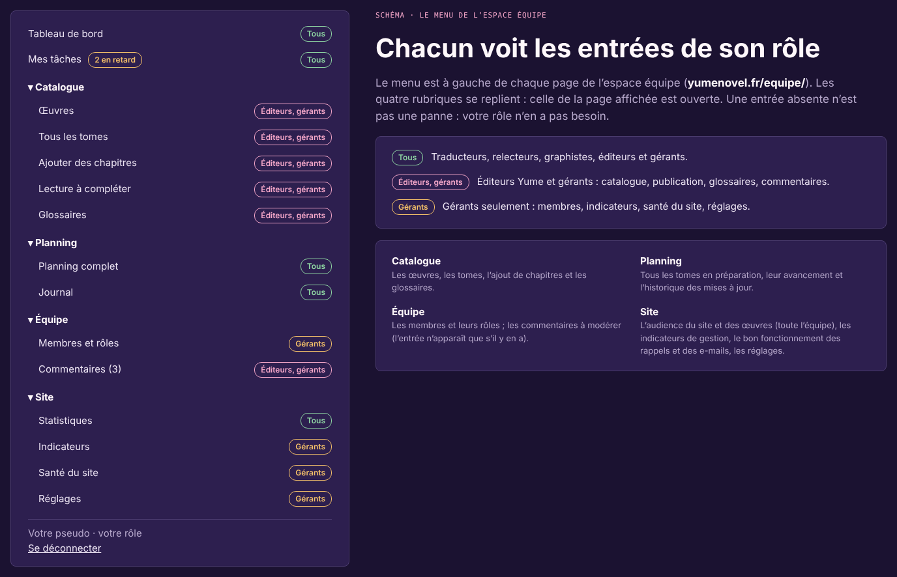

> **À savoir** : la pastille à côté de **Mes tâches** compte vos retards. L'entrée **Commentaires** n'apparaît que s'il y a des commentaires à modérer.

## Utiliser les raccourcis d'un tome

Sous chaque tâche et chaque tome du planning, des liens mènent directement au bon écran :

- **Publier ce tome** (éditeurs) : ouvre « Ajouter des chapitres » avec ce tome déjà choisi ;
- **Gérer dans le planning complet** : ouvre la ligne du tome dans le planning ;
- **Voir la fiche** : la page publique du tome, s'il est en ligne ;
- **Historique** : le journal de ce tome ;
- **Modifier dans l'administration** : l'écran avancé de WordPress (rarement utile).

# Le planning

Le planning public (**yumenovel.fr/planning/**) montre aux lecteurs où en est chaque tome. Il se met à jour uniquement avec ce que l'équipe saisit. Pensez-y à chaque avancée.

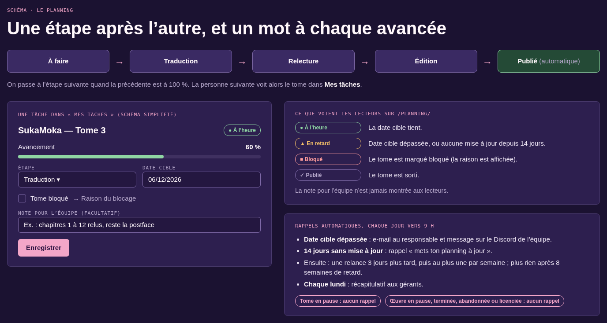

## Mettre à jour son avancement

1. Ouvrez **Mes tâches** dans le menu. Les tâches en retard sont en tête.
2. Trouvez le tome.
3. Faites glisser le curseur **Avancement** (de 0 à 100 %) de votre étape.
4. Si votre étape est finie, choisissez l'étape suivante dans **Étape** : *À faire*, *Traduction*, *Relecture*, *Édition*. La personne suivante verra alors le tome dans ses tâches.
5. Vérifiez la **Date cible** : la date de sortie visée.
6. Si besoin, écrivez un mot dans **Note pour l'équipe (facultatif)**. Les lecteurs ne la voient jamais.
7. Cliquez sur **Enregistrer**.

> **À savoir** : on ne passe à l'étape suivante que si les étapes précédentes sont à 100 %. Seuls les gérants peuvent forcer une étape. L'étape **Publié** se pose toute seule à la sortie du tome.

> **À savoir** : vous ne pouvez modifier que les tomes dont vous êtes responsable, et seulement votre étape. Un tome manque dans vos tâches ? Demandez à un éditeur ou à un gérant de vous l'attribuer.

## Signaler un tome bloqué

Un tome ne peut plus avancer (relecteur manquant, illustrations en attente…) :

1. Dans **Mes tâches**, trouvez le tome.
2. Cochez **Tome bloqué**.
3. Écrivez la raison dans **Raison du blocage**. Elle s'affiche sur le planning public.
4. Cliquez sur **Enregistrer**.

Quand le tome repart, décochez **Tome bloqué** et enregistrez.

## Mettre à jour une tâche « En attente »

Une tâche **En attente** attend l'étape précédente : par exemple, la relecture attend la fin de la traduction. Elle n'est pas en retard pour vous. Pour la modifier quand même, cliquez sur **Mettre à jour quand même**, remplissez, puis **Enregistrer**.

## Comprendre ce que voient les lecteurs

| État sur le planning public | Signification |
| --- | --- |
| **À l'heure** | La date cible tient. |
| **En retard** | La date cible est dépassée, **ou** personne n'a mis le tome à jour depuis 14 jours. |
| **Bloqué** | Le tome est marqué bloqué. La raison est affichée. |
| **Publié** | Le tome est sorti. |
| **En cours de publication** | Le tome sort chapitre par chapitre, lisible en ligne au fil des sorties. |
| **Chapitre programmé** | La date et l'heure de sortie du prochain chapitre. |

Les lecteurs voient l'étape, les pourcentages, le pseudo des responsables et la date cible, avec l'heure de sortie quand elle est connue. Ils ne voient jamais la note pour l'équipe. Le tome d'une **série à venir** y figure sous le nom affiché au public, sans le titre de l'œuvre (voir « Annoncer une nouvelle série sans dévoiler son titre »). Le planning nourrit aussi la section **Planning** de l'accueil : voir « Ce que voient les lecteurs ».

## Recevoir (ou ne plus recevoir) les rappels

Chaque jour vers 9 h, le site relit le planning :

- **date cible dépassée** : e-mail au responsable et message sur le Discord de l'équipe ;
- **aucune mise à jour depuis 14 jours** : rappel « mets ton planning à jour » ;
- **chaque lundi** : récapitulatif envoyé aux gérants.

Les rappels d'un même tome s'espacent : un premier rappel, une relance trois jours plus tard, puis au plus un par semaine. Après 8 semaines de retard, le site ne relance plus personne : le tome reste seulement dans le récapitulatif des gérants.

Pour ne plus recevoir de rappel : mettez le tome à jour. Même un petit pourcentage compte.

> **À savoir** : un tome **en pause** ne reçoit jamais de rappel (voir « Mettre un tome en pause »).

> **Nouveau** : version 2.1.5. Une œuvre **en pause**, **terminée**, **abandonnée** ou **licenciée** n'envoie plus aucun rappel ni alerte de retard, pour aucun de ses tomes. Voir le chapitre « Nouveau (version 2.1.5) : l'état des tomes et des œuvres ».

## Mettre un tome en pause

Réservé aux éditeurs et aux gérants. Pour un tome arrêté volontairement : attente de la VO, équipe indisponible, tome ancien jamais repris.

1. Dans le menu, ouvrez **Planning**, puis **Planning complet**.
2. Dépliez la ligne du tome.
3. Cliquez sur **Mettre en pause**.

Le tome n'est plus jamais en retard et ne reçoit plus de rappel. Un badge **En pause** le signale dans l'espace équipe. Les lecteurs ne voient rien.

Le jour où le tome repart : même chemin, bouton **Reprendre**.

## Retirer un tome ajouté par erreur

Réservé aux éditeurs et aux gérants, pour un tome **brouillon sans aucun chapitre en ligne**.

1. **Planning complet**, puis dépliez la ligne du tome.
2. Cliquez sur **Retirer du planning** et confirmez.

Le tome part à la corbeille. Un administrateur peut le récupérer. Un tome qui a des chapitres en ligne ne se retire pas ici.

## Trouver un tome dans le planning complet

**Planning complet** montre tous les tomes : en préparation, programmés, publiés.

- Filtrez par **Œuvre**, **État**, **Statut** ou responsable, puis **Filtrer**. **Afficher tout le planning** retire les filtres.
- Le tri **En retard d'abord** met en tête les tomes les plus en retard.
- **Exporter en CSV** télécharge le planning affiché, pour Excel ou LibreOffice.
- **Voir le planning public** ouvre la page vue par les lecteurs.

# Les œuvres

Réservé aux éditeurs et aux gérants. Menu **Catalogue**, puis **Œuvres**.

## Créer une œuvre

1. Ouvrez **Catalogue**, puis **Œuvres**.
2. Cliquez sur **Nouvelle œuvre**.
3. Remplissez au moins le **Titre** et le **Type**. Ajoutez le **Statut de la traduction**, l'**Auteur**, l'**Illustrateur**, l'**Éditeur VO** et les **Genres**. Pour un manga que l'équipe publie sur MangaDex, voir aussi « Lier un manga à sa série MangaDex ».
4. Écrivez le **Synopsis**. Une ligne vide sépare deux paragraphes.
5. Ajoutez la couverture : JPG, PNG ou WebP, au format portrait de préférence.
6. Si besoin, dépliez **Fiche détaillée : VO, jours de sortie, équipe, liens**.
7. Pour annoncer la série sans dévoiler son titre, utilisez la section **Annonce au planning** (voir « Annoncer une nouvelle série sans dévoiler son titre »).
8. Cliquez sur **Créer en brouillon** (invisible du public) ou sur **Créer et publier** (visible tout de suite dans la bibliothèque).

> **À savoir** : publier une œuvre n'envoie aucune annonce. Seuls les tomes et les chapitres sont annoncés.

> **Astuce** : une œuvre en brouillon peut déjà recevoir des tomes au planning. Publiez-la ensuite d'un clic avec **Publier**, sur sa ligne.

> **Attention** : un titre déjà pris par une autre œuvre, même en brouillon, est refusé. Cherchez d'abord l'œuvre dans la liste.

## Modifier une œuvre et cadrer sa couverture

1. Dans **Œuvres**, cliquez sur **Modifier** à côté de l'œuvre.
2. Changez ce qu'il faut.
3. Sous **Cadrage de la couverture**, cliquez dans l'aperçu sur la partie à garder visible, ou réglez les curseurs. **Recentrer** revient au cadrage par défaut.
4. Cliquez sur **Enregistrer**.

Sur chaque ligne de la liste, vous trouvez aussi **Ajouter un tome au planning** (ouvre « Nouveau tome » avec l'œuvre déjà choisie) et **Ajouter des chapitres**.

## Annoncer une nouvelle série sans dévoiler son titre

Pour mettre au planning le Tome 1 d'une série dont le titre doit rester secret. Les lecteurs voient « Nouvelle série à venir » (ou le nom de votre choix) et la date, sans le titre.

1. Ouvrez **Catalogue**, puis **Œuvres**, et cliquez sur **Nouvelle œuvre**. Remplissez la fiche comme d'habitude (voir « Créer une œuvre »).
2. Dans la section **Annonce au planning**, cochez **Série à venir : cacher le titre au public**.
3. Si vous le souhaitez, remplissez **Nom affiché au public** (par exemple « Nouvelle romance à venir »). Vide, les lecteurs voient « Nouvelle série à venir ».
4. Cliquez sur **Créer en brouillon**. L'œuvre peut rester en brouillon jusqu'à la révélation.
5. Sur la ligne de l'œuvre, cliquez sur **Ajouter un tome au planning**, puis créez le **Tome 1** avec sa **Date cible du tome** et son **Heure de sortie** (voir « Créer le tome »).

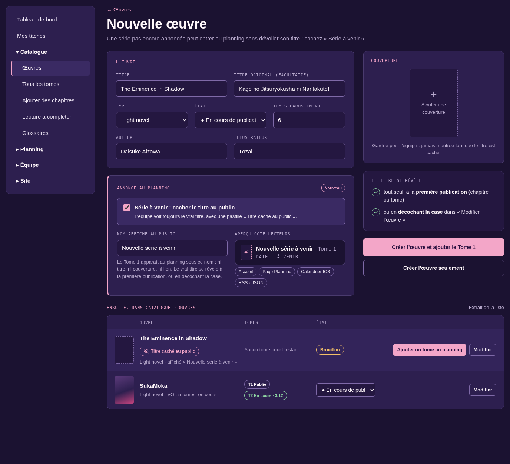

Ce que voient les lecteurs, partout (accueil, page Planning, calendrier ICS, flux RSS et JSON, journal public) : le nom affiché à la place du titre, sans sous-titre de tome, sans lien, sans couverture et sans bouton **Suivre l'œuvre**. La date, l'heure, l'étape et l'avancement restent visibles.

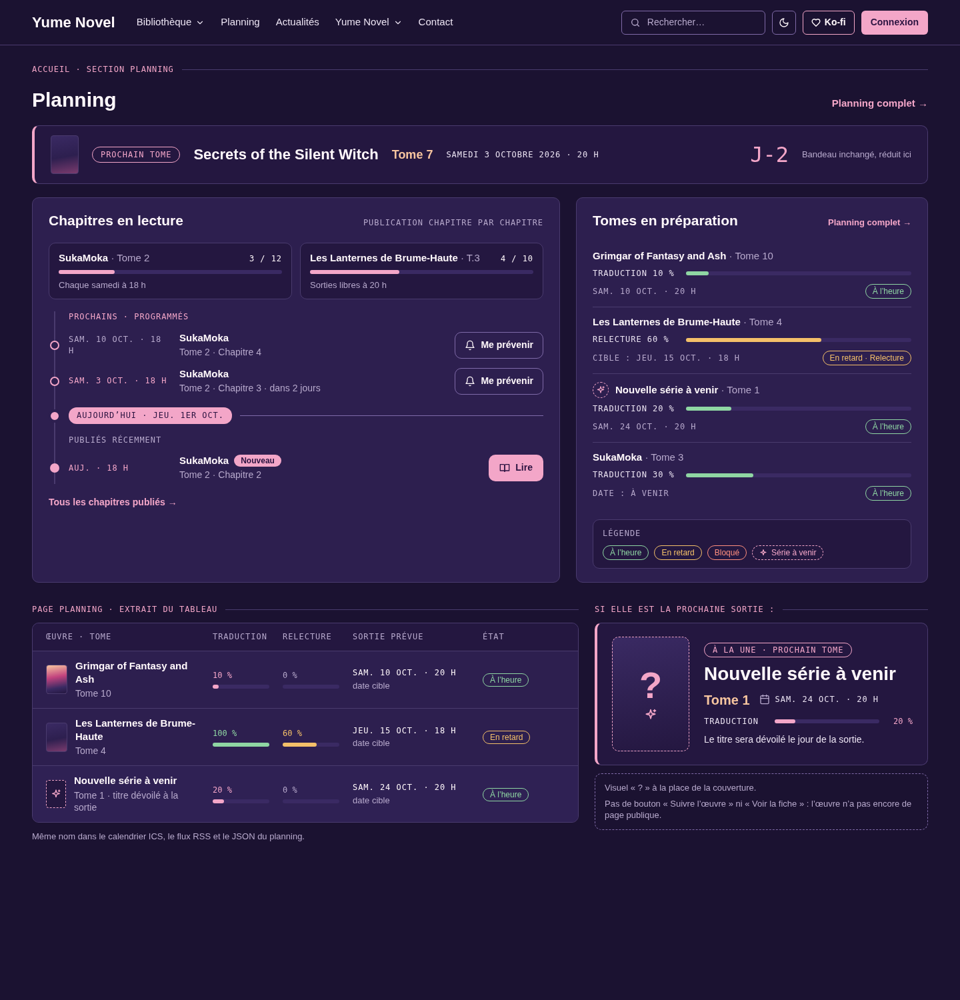

Dans l'espace équipe, rien n'est caché : le vrai titre s'affiche partout, avec la pastille **Titre caché au public**.

Pour révéler le titre :

- à la main : **Modifier** l'œuvre, décochez **Série à venir : cacher le titre au public**, puis **Enregistrer** ;
- ou sans rien faire : le titre est révélé tout seul à la première publication de l'œuvre, ou d'un de ses tomes ou chapitres. Le journal de l'équipe le note.

> **À savoir** : la case existe aussi dans **Modifier** l'œuvre, pour une œuvre déjà créée.

> **Attention** : seule une série à venir apparaît au planning public en brouillon. Les autres œuvres en brouillon restent invisibles des lecteurs, leurs tomes compris.

## Gérer les genres

En bas de la page **Œuvres**, la liste **Genres** propose une trentaine de genres courants. Pour en ajouter, écrivez-les dans **Nouveaux genres (séparés par des virgules)**, puis **Ajouter**. **Supprimer** retire un genre de toutes les œuvres qui l'avaient.

> **Nouveau** : version 2.1.5. L'état de chaque œuvre (en cours de publication, terminée, en pause, abandonnée, licenciée) se change directement dans la liste **Œuvres**. Voir « Changer l'état d'une œuvre ».

# Les mangas (MangaDex)

Les mangas de l'équipe sont publiés sur MangaDex. Le site les reprend tout seul et les fait lire sur yumenovel.fr, sans stocker aucune image : chaque page est relayée depuis MangaDex au moment de la lecture.

Pour un manga, vous ne créez **ni tome ni chapitre** sur le site, et vous n'utilisez pas **Ajouter des chapitres** (réservé aux fichiers Word et EPUB des romans). Une fois l'œuvre liée à sa série, la synchronisation crée elle-même les tomes (un par volume MangaDex) et les chapitres, à mesure qu'ils sont publiés sur MangaDex.

| Ce que vous faites | Ce que fait le site |
| --- | --- |
| Créer l'œuvre (type **Manga**) avec son **Lien MangaDex de la série** | Rien encore |
| Publier un chapitre sur MangaDex | Crée le tome du volume s'il n'existe pas, puis le chapitre, au plus une heure après ; annonce |
| (Facultatif) Annoncer un tome au planning avec **Nouveau tome** | Range les chapitres du volume dans ce tome et le publie à son premier chapitre |

## Lier un manga à sa série MangaDex

Réservé aux éditeurs et aux gérants.

1. Ouvrez **Catalogue**, puis **Œuvres**, et cliquez sur **Nouvelle œuvre** (ou sur **Modifier** à côté d'une œuvre existante).
2. Dans **Type**, choisissez **Manga**. Le champ **Lien MangaDex de la série (manga)** apparaît sous la grille.
3. Sur MangaDex, ouvrez la page de la série et copiez son adresse (elle commence par `https://mangadex.org/title/`). Collez-la dans **Lien MangaDex de la série (manga)**.
4. Cliquez sur **Créer et publier** (ou sur **Enregistrer**).

Dans la liste **Œuvres**, l'œuvre porte la pastille **MangaDex**. Un manga sans lien porte la pastille **Lien MangaDex manquant**.

> **À savoir** : le lien est facultatif. Un manga peut être créé avant sa sortie sur MangaDex, puis lié plus tard avec **Modifier**.

> **Attention** : collez l'adresse de la **série**, pas celle d'un chapitre ni du groupe : elle est refusée. Une série déjà liée à une autre œuvre est refusée aussi.

> **À savoir** : l'œuvre doit être **publiée** pour que ses chapitres arrivent sur le site. Une œuvre en brouillon est ignorée.

## Publier un chapitre de manga

1. Publiez le chapitre sur MangaDex, avec le groupe Yume Novel, comme d'habitude.
2. Attendez la synchronisation suivante : au plus une heure. Le chapitre apparaît sur le site, dans le tome de son volume (ou dans un tome **Chapitres** s'il n'a pas de volume), daté de sa sortie sur MangaDex.
3. Le chapitre est annoncé comme les autres (Discord, e-mails, notifications).

> **Attention** : un chapitre publié sur MangaDex y est **public tout de suite**. Le site ne peut que le reprendre une heure plus tard au plus, jamais le cacher. Pour un chapitre qui ne doit pas encore sortir, ne le publiez pas sur MangaDex, ou programmez-le là-bas.

> **À savoir** : la toute première synchronisation d'une œuvre ajoute ses chapitres déjà parus **sans aucune annonce**. Seuls les chapitres suivants sont annoncés.

> **À savoir** : un chapitre corrigé sur MangaDex (titre, volume, pages) est mis à jour sur le site à la synchronisation suivante, à la même adresse et sans nouvelle annonce.

## Annoncer un tome de manga au planning

Facultatif : pour montrer aux lecteurs un tome à venir (date cible, avancement), avant que ses chapitres ne sortent sur MangaDex.

1. Ouvrez **Nouveau tome** (voir « Créer un tome vide »). Aucun fichier n'est demandé.
2. Choisissez l'œuvre, la **Nature** **Tome** et, comme **Numéro**, le numéro du volume sur MangaDex.
3. Remplissez le calendrier comme pour un roman, puis cliquez sur **Créer le tome**. Ne cliquez pas sur **Créer le tome et ajouter un chapitre** : il ouvre « Ajouter des chapitres », qui attend un fichier.

Au premier chapitre de ce volume publié sur MangaDex, la synchronisation range le chapitre dans ce tome et le publie (« En cours de publication »). Les chapitres suivants du volume s'y ajoutent.

> **À savoir** : un chapitre sans volume sur MangaDex va dans un tome **Chapitres**, créé tout seul. Dès que le volume est renseigné sur MangaDex, le chapitre rejoint son tome.

> **Attention** : un tome déjà paru puis retiré par l'équipe n'est pas remis en ligne par la synchronisation. Le rapport le signale : republiez-le vous-même si besoin.

## Vérifier la synchronisation

Réservé aux gérants.

1. Dans l'administration WordPress, ouvrez **Yume**, puis **Mangas (MangaDex)**.
2. Lisez **Dernière synchronisation** : chapitres créés, mis à jour, retirés, et les éventuelles alertes.
3. Pour voir ce que ferait la synchronisation sans rien changer, cliquez sur **Simuler (sans rien changer)**.
4. Pour ne pas attendre l'heure suivante, cliquez sur **Synchroniser maintenant**. Ce bouton n'apparaît qu'une fois la synchronisation activée (voir ci-dessous).

| Rubrique du rapport | Ce qu'elle veut dire |
| --- | --- |
| **Séries du groupe liées à aucune œuvre** | Le groupe publie une série sur MangaDex, mais aucune œuvre du site n'a son lien. Créez ou modifiez l'œuvre (voir « Lier un manga à sa série MangaDex »). |
| **Œuvres liées mais non publiées (ignorées)** | L'œuvre est en brouillon : publiez-la. |
| **Œuvres licenciées (ignorées)** | L'œuvre est « Licenciée » : rien n'est repris tant qu'elle l'est. |
| **Chapitres hors ligne mis à jour (restent hors ligne)** | Chapitres mis en brouillon par l'équipe et modifiés sur MangaDex : leur titre est mis à jour, ils restent hors ligne. |
| **Chapitres en double sur MangaDex (ignorés)** | Le même chapitre a été envoyé plusieurs fois sur MangaDex. Le site garde celui déjà en ligne (sinon le premier sorti). Supprimez le doublon sur MangaDex avec le lien du rapport. |

> **À savoir** : la synchronisation est coupée par défaut. Un gérant l'active une fois, dans **Réglages**, section **Mangas (MangaDex)**, case **Synchroniser les chapitres**.

## Retirer un chapitre ou un manga

| Demande | Que faire |
| --- | --- |
| Un chapitre ne doit plus être lisible sur le site | Mettez-le en brouillon (voir « Publier, reprogrammer ou retirer un chapitre »). La synchronisation ne le remet jamais en ligne. |
| Le manga est licencié en France, ou un éditeur demande son retrait | Passez l'œuvre à l'état **Licenciée** (voir « Changer l'état d'une œuvre »). La lecture est retirée tout de suite et la synchronisation ignore l'œuvre. C'est réversible. |
| Le chapitre a été supprimé sur MangaDex | Rien à faire : le site le retire à la synchronisation suivante. Il revient seul s'il réapparaît. |

> **Attention** : retirer un chapitre du site ne le retire pas de MangaDex. Pour une demande de retrait complète, supprimez-le aussi sur MangaDex.

# Créer un tome vide

Un tome se crée d'abord vide, sans fichier : il entre au planning. Ses chapitres arrivent ensuite avec « Ajouter des chapitres ». Réservé aux éditeurs et aux gérants.

## Ouvrir la page « Nouveau tome »

Plusieurs boutons ouvrent la même page :

- **Nouveau tome**, en haut de **Tous les tomes** ou sous **Tomes en préparation** du tableau de bord ;
- **Ajouter un tome au planning**, dans **Planning complet** ou sur la ligne d'une œuvre (l'œuvre est alors déjà choisie).

## Créer le tome

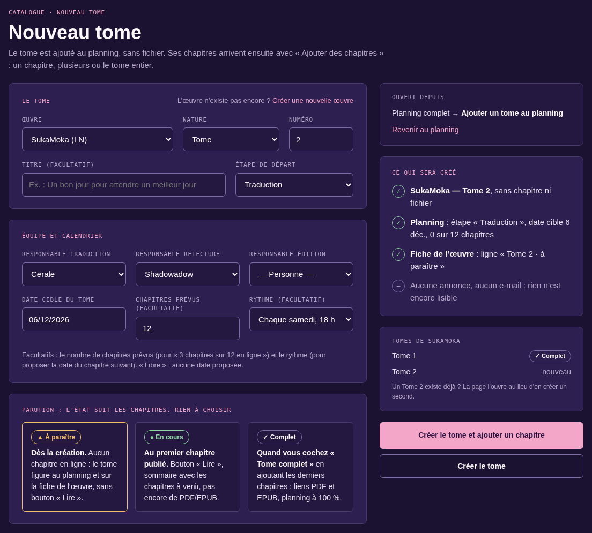

1. Dans **Le tome**, choisissez l'**Œuvre**. Elle n'existe pas encore ? Cliquez sur **Créer une nouvelle œuvre**.
2. Choisissez la **Nature** (Tome, Arc, Tome EX, Bonus…) et le **Numéro**. Un tome intermédiaire peut avoir un numéro comme 26,5.
3. Si le tome a un titre, remplissez **Titre (facultatif)**.
4. Choisissez l'**Étape de départ** du planning.
5. Dans **Équipe et calendrier**, choisissez les responsables (traduction, relecture, édition) et la **Date cible du tome**.
6. À côté, vérifiez l'**Heure de sortie**. 18:00 est proposé : changez-la si le tome sort à une autre heure. Si l'heure n'est pas encore connue, videz le champ.
7. Indiquez les **Chapitres prévus (facultatif)** : le site affichera alors « 3 chapitres sur 12 en ligne ».
8. Choisissez le **Rythme (facultatif)** : un jour de la semaine, ou « Libre ». Avec un jour, le site proposera la date du chapitre suivant. « Libre » : aucune date proposée.
9. Relisez **Ce qui sera créé**, à droite.
10. Cliquez sur **Créer le tome** (ouvre la fiche du tome) ou sur **Créer le tome et ajouter un chapitre** (ouvre « Ajouter des chapitres » avec ce tome).

> **À savoir** : rien n'est encore lisible. Aucune annonce, aucun e-mail. Le tome apparaît au planning et sur la fiche de l'œuvre comme « à paraître ».

> **Astuce** : si l'œuvre a déjà un tome de même nature et de même numéro, sa fiche s'ouvre au lieu d'en créer un second. Pas de doublon possible.

> **À savoir** : le **Rythme** n'a plus son propre champ d'heure : il reprend l'**Heure de sortie** du tome. L'heure est toujours enregistrée, même avec le rythme « Libre ».

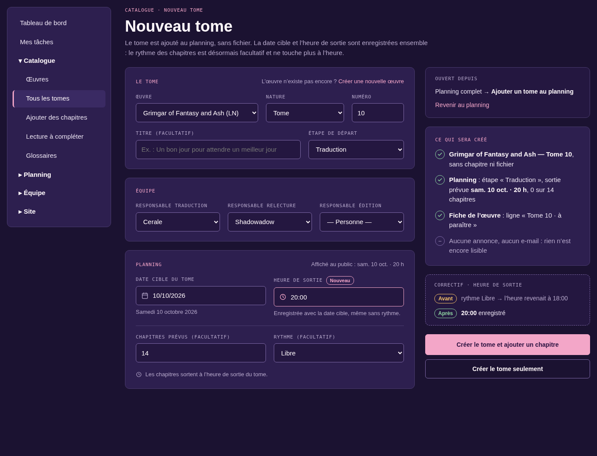

> **Nouveau** : quand l'heure est connue, les lecteurs la voient avec la date, par exemple « sam. 10 oct. · 20 h » : page Planning, bandeau **À la une : prochain tome** de l'accueil (« Aujourd'hui à 20 h » le jour même) et calendrier ICS. Sans heure, seule la date s'affiche.

## Comprendre la parution d'un tome

L'état d'un tome suit ses chapitres : le site le met à jour tout seul.

| État (équipe) | Les lecteurs voient | Quand |
| --- | --- | --- |
| **Planifié** | À paraître | Dès la création, tant qu'aucun chapitre n'est en ligne. Le tome figure au planning, sans bouton « Lire ». |
| **En cours de publication** | En cours | Au premier chapitre publié. Le tome se lit en ligne, ses chapitres sortent au fil de l'eau. |
| **Publié** | Publié | Quand l'équipe coche « Le tome est complet : tout publier maintenant », à la sortie du dernier chapitre avec « Publier les liens avec le dernier chapitre », ou quand elle choisit « Publié ». Tous les chapitres sont en ligne, les liens PDF et EPUB s'affichent. |

> **Nouveau** : version 2.1.5. L'équipe peut aussi changer l'état du tome à la main : **Planifié**, **En cours de publication** ou **Publié**. Voir le chapitre « Nouveau (version 2.1.5) : l'état des tomes et des œuvres ».

# Préparer le fichier Word

Le fichier Word (DOCX) du tome est la source de la lecture en ligne. Le site le découpe tout seul en chapitres, à condition d'utiliser les bons styles. Le fichier n'est pas gardé sur le site : seuls les chapitres et les illustrations restent.

## Utiliser les bons styles

| Dans Word | Sur le site |
| --- | --- |
| Style **Titre 1** : « Chapitre 1 », « Chapitre 2 »… | Un nouveau chapitre (une page de lecture) |
| Style **Titre 2** juste après le Titre 1 | Le sous-titre du chapitre |
| Style **Titre 2** seul : « Prologue », « Postface »… | Un chapitre spécial, sans numéro |
| Paragraphe qui commence par « — », ou liste à puce « — » | Un dialogue (tiret long, en retrait) |
| Style **Pensée** | Une pensée (italique, en retrait) |
| Paragraphe centré | Un paragraphe centré |
| `***`, `* * *` ou `◇` seul sur une ligne | Un changement de scène |
| Image JPG, PNG ou WebP dans le texte | Une illustration pleine largeur |
| Images placées avant le premier Titre 1 | La galerie d'illustrations du tome |
| Notes de bas de page | Des notes en fin de chapitre |

Les en-têtes et pieds de page de Word sont ignorés. Les sauts de page ne changent rien au texte.

## Écrire les dialogues et les pensées

- Un dialogue commence par un tiret long « — » (tiret cadratin). Dans Word : **Ctrl + Alt + -** (signe moins du pavé numérique), ou copiez-le.
- Une pensée utilise le style **Pensée**. Ne la mettez pas seulement en italique : le site ne la reconnaîtrait pas comme une pensée.

## Décrire les illustrations

Le **texte de remplacement** d'une image devient sa description pour les lecteurs aveugles ou malvoyants.

1. Dans Word, faites un clic droit sur l'image.
2. Choisissez **Afficher le texte de remplacement**.
3. Si la case « Marquer comme décoratif » est cochée, décochez-la.
4. Écrivez une phrase courte qui décrit l'illustration : qui, quoi, où.

> **Attention** : les descriptions écrites par Word tout seul (« Une image contenant texte… », « Le contenu généré par l'IA peut être incorrect ») sont ignorées par le site. Écrivez la vôtre. Sans texte, le site met « Œuvre, Tome N, Chapitre N — illustration ».

## Forcer un début de chapitre avec un marqueur

Quand le découpage automatique se trompe (roman sans styles de titre, histoire bonus avant le premier chapitre…), ajoutez un paragraphe seul, sur sa propre ligne, au début de chaque chapitre :

| Marqueur | Effet |
| --- | --- |
| `[chapitre]` ou `[chapitre] Titre` | Un chapitre numéroté, avec ce titre |
| `[prologue]`, `[épilogue]`, `[postface]` | Un chapitre spécial |
| `[interlude] Titre`, `[bonus] Titre` | Un interlude ou un bonus, avec ce titre |

Le marqueur n'est jamais publié. Majuscules et accents sont indifférents.

> **Astuce** : sans toucher au fichier, vous pouvez aussi découper les chapitres à la souris, sur le site. Voir « Découper soi-même les chapitres ».

## Vérifier le fichier avant de l'envoyer

1. Chaque chapitre commence par un **Titre 1**.
2. Les dialogues commencent par « — ».
3. Les pensées utilisent le style **Pensée**.
4. Chaque illustration a son texte de remplacement.
5. Le fichier ne contient que les chapitres à publier, ou le tome avec ses chapitres déjà en ligne (ils seront reconnus et laissés tels quels).

# Ajouter des chapitres à un tome

Réservé aux éditeurs et aux gérants. Un seul formulaire sert à tous les cas : un chapitre, plusieurs, ou le tome entier. Menu **Catalogue**, puis **Ajouter des chapitres**. Ou, dans **Tous les tomes**, le bouton **Ajouter des chapitres** sur la ligne du tome : le tome est alors déjà choisi.

## Comprendre le formulaire

Le formulaire a trois parties numérotées et un résumé à droite.

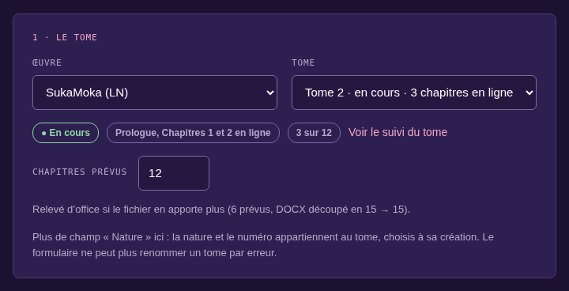{largeur=80%}

**1 · Le tome** : choisissez l'**Œuvre**, puis le **Tome**. La liste montre la parution de chaque tome. La nature et le numéro du tome ne changent jamais ici. Le tome n'existe pas ? **+ Nouveau tome**.

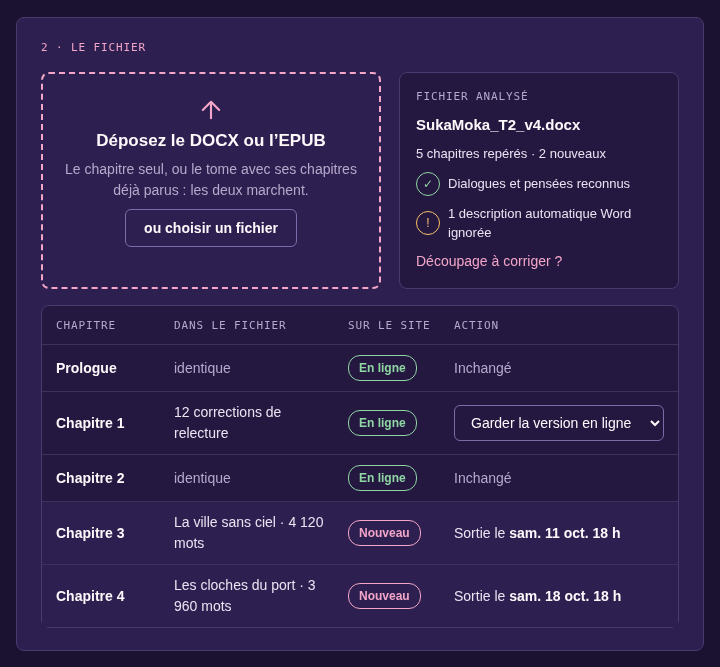{largeur=80%}

**2 · Le fichier** : déposez le DOCX (ou l'EPUB). Le site compare chaque chapitre du fichier aux chapitres du tome :

| Sur le site | Ce qui se passe |
| --- | --- |
| **Nouveau** | Le chapitre est ajouté au tome. Il sort selon la partie 3. |
| **En ligne, identique** | Rien ne change. |
| **En ligne, modifié** | Au choix : **Garder la version en ligne** (par défaut) ou **Mettre à jour (sans annonce)**. |
| **Programmé** ou **Brouillon** | Pas encore visible des lecteurs : mis à jour. |

Rien n'est jamais retiré : un chapitre en ligne absent du fichier reste en ligne.

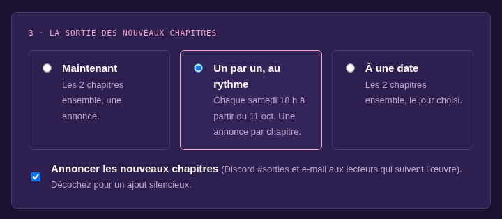{largeur=80%}

**3 · La sortie des nouveaux chapitres** :

- **Maintenant** : les nouveaux chapitres ensemble, une seule annonce ;
- **Un par un, au rythme** : un chapitre à chaque date du rythme du tome (par exemple chaque samedi à 18 h), une annonce à chaque sortie ;
- **À une date** : les nouveaux chapitres ensemble, le jour choisi.

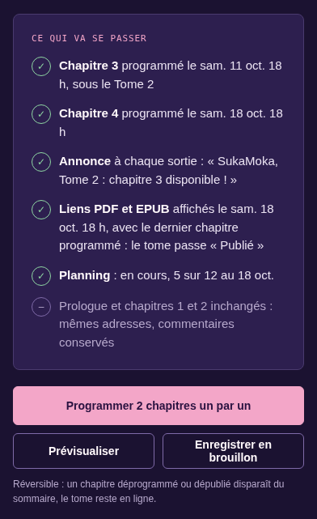{largeur=45%}

**Ce qui va se passer** résume l'envoi avant de cliquer : chapitres créés et leur date, annonces, planning. Le bouton d'envoi dit exactement ce qu'il va faire : « Publier 1 chapitre », « Programmer 2 chapitres un par un »… **Prévisualiser** et **Enregistrer en brouillon** ne montrent rien aux lecteurs.

## Publier le prologue d'un tome en cours

Exemple : SukaMoka, Tome 2. Le tome a été créé avec « Nouveau tome ». On publie d'abord le prologue seul.

1. Ouvrez **Ajouter des chapitres**.
2. Dans **1 · Le tome**, choisissez l'œuvre, puis le tome (il est « à paraître »).
3. Dans **2 · Le fichier**, déposez un DOCX qui contient **seulement le prologue**.
4. Vérifiez le tableau : le prologue est **Nouveau**.
5. La première fois, ajoutez la **Couverture** du tome (zone « Glissez l'image ici ») et remplissez les **Crédits du tome** à droite : **Traduction**, **Relecture**, **Édition / couverture**.
6. Dans **3 · La sortie des nouveaux chapitres**, choisissez **Maintenant**.
7. Laissez cochée **Annoncer les nouveaux chapitres**. Ne cochez ni **Publier les liens avec le dernier chapitre** ni **Le tome est complet : tout publier maintenant**.
8. Relisez **Ce qui va se passer**, puis cliquez sur **Publier 1 chapitre**.
9. Une fenêtre demande confirmation : cliquez sur **OK**.

Résultat : le prologue est en ligne. Le tome passe « En cours ». Un article et un message Discord annoncent « SukaMoka, Tome 2 : Prologue disponible ! » et les lecteurs qui suivent l'œuvre reçoivent un e-mail. Au planning, l'avancement suit les chapitres en ligne.

> **Attention** : tous les chapitres **Nouveau** du fichier sortent ensemble. Pour publier seulement le prologue, déposez un fichier qui ne contient que lui. Ou bien programmez les chapitres suivants (procédure suivante).

## Programmer plusieurs chapitres au rythme

Exemple : les chapitres 3 et 4 doivent sortir les deux samedis suivants, à 18 h.

1. Ouvrez **Ajouter des chapitres** et choisissez le tome.
2. Déposez le DOCX. Il peut contenir tout le tome : les chapitres déjà en ligne sont reconnus (**En ligne, identique**) et ne bougent pas.
3. Vérifiez que les chapitres 3 et 4 sont **Nouveau**. La colonne « Action » donne leur date de sortie.
4. Choisissez **Un par un, au rythme**. Le premier chapitre sort à la prochaine date du rythme, après le dernier chapitre déjà programmé.
5. Laissez cochée **Annoncer les nouveaux chapitres**.
6. Cliquez sur **Programmer 2 chapitres un par un**, puis confirmez.

Chaque chapitre sort à sa date, avec sa propre annonce : « SukaMoka, Tome 2 : chapitre 3 disponible ! ».

> **À savoir** : le fichier contient plus de chapitres que prévu (tome planifié à 6 chapitres, DOCX découpé en 15) ? Le champ **Chapitres prévus** de la fiche du tome, en haut du formulaire, est relevé d'office à 15 à l'enregistrement. Vous pouvez aussi y saisir le bon nombre vous-même.

> **À savoir** : le tome n'a pas de rythme ? Indiquez la **Date** de départ et le nombre de jours dans **Un chapitre tous les (jours)** (7 par défaut). Pour donner un rythme au tome, voir « Modifier les informations d'un tome ».

## Publier un tome entier d'un coup

Pour un tome traduit en entier, publié en une fois avec ses liens de téléchargement.

1. Créez le tome avec **Nouveau tome**, puis cliquez sur **Créer le tome et ajouter un chapitre**.
2. Déposez le DOCX complet. Tous les chapitres sont **Nouveau**.
3. Cochez **Le tome est complet : tout publier maintenant**. Les choix de sortie se grisent : tout part maintenant.
4. Collez le **Lien de téléchargement · PDF** et le **Lien de téléchargement · EPUB**.
5. Relisez **Ce qui va se passer**, puis cliquez sur **Publier** (le bouton donne le nombre de chapitres) et confirmez.

Résultat : tous les chapitres sont en ligne, le tome est « Publié », les liens s'affichent et le planning passe à « Publié », 100 %. L'annonce dit « Le tome 2 de SukaMoka est disponible ! ».

> **À savoir** : pour programmer la sortie du tome entier à une date, ne cochez pas « tout publier maintenant » : choisissez **À une date**, cochez **Publier les liens avec le dernier chapitre** et collez les liens. Tout sort ensemble à cette date, comme un tome complet.

## Donner tout le tome, chapitre par chapitre, avec les liens à la fin

Exemple : le tome 2 est traduit en entier. Vous voulez sortir un chapitre chaque samedi, et que les liens PDF et EPUB apparaissent avec le dernier chapitre.

1. Ouvrez **Ajouter des chapitres** et choisissez le tome.
2. Déposez le DOCX complet. Vérifiez **Chapitres prévus** dans la fiche du tome : il est relevé d'office si le fichier contient plus de chapitres.
3. Choisissez **Un par un, au rythme**.
4. Collez le **Lien de téléchargement · PDF** et le **Lien de téléchargement · EPUB**.
5. Cochez **Publier les liens avec le dernier chapitre**.
6. Relisez **Ce qui va se passer** : il donne la date à laquelle le tome passera « Publié ». Cliquez sur **Programmer…**, puis confirmez.

Chaque chapitre sort à sa date, avec son annonce. À la sortie du dernier, le tome passe « Publié » : les liens s'affichent, le planning passe à 100 % et l'annonce dit « Le tome 2 de SukaMoka est complet : PDF et EPUB disponibles ». D'ici là, les liens restent masqués aux lecteurs.

> **À savoir** : vous changez d'avis ? Un nouvel envoi avec **Le tome est complet : tout publier maintenant** sort tout de suite les chapitres encore programmés et affiche les liens.

> **À savoir** : les fichiers PDF et EPUB ne sont jamais envoyés sur le site. Ce sont seulement des liens vers leur hébergement (ClicTune, Mega…).

## Corriger un chapitre déjà en ligne

Pour des coquilles ou des corrections de relecture, sans prévenir les lecteurs.

1. Corrigez le texte dans le fichier Word.
2. Ouvrez **Ajouter des chapitres** et choisissez le tome.
3. Déposez le fichier corrigé.
4. Le chapitre corrigé apparaît **En ligne, modifié**. Dans sa colonne « Action », choisissez **Mettre à jour (sans annonce)**.
5. Les autres chapitres en ligne restent **Inchangé** ou **Garder la version en ligne** : ils ne bougent pas.
6. Cliquez sur le bouton d'envoi. S'il n'y a aucun nouveau chapitre, il s'appelle **Enregistrer (aucun nouveau chapitre)**.

Le chapitre est remplacé à la même adresse. Ses commentaires et sa date sont gardés. Aucune annonce n'est envoyée.

> **Astuce** : pour une seule coquille, un éditeur peut aussi corriger le texte directement dans l'administration WordPress (fiche du tome, lien **Édition avancée (administration WordPress)**), ou depuis **Corrections** avec **Corriger dans l'éditeur** (voir « Les coquilles signalées par les lecteurs »). Traducteurs, relecteurs et graphistes : signalez la coquille à un éditeur sur le Discord de l'équipe.

## Découper soi-même les chapitres

Quand le découpage automatique se trompe : chapitres séparés par une illustration ou un saut de page, roman sans styles de titre…

1. Déposez le fichier. Sous le tableau des chapitres, ouvrez **Délimiter les chapitres moi-même**.
2. Le tableau **Débuts de chapitre possibles** liste les endroits repérés : titres, illustrations, sauts de page, lignes courtes, centrées ou en gras.
3. Cochez **Début de chapitre** sur chaque ligne où un chapitre commence.
4. Pour chaque début coché, choisissez la nature (chapitre, prologue, bonus…) et, si besoin, le **Titre**.
5. Si besoin, changez le **Premier numéro de chapitre**.
6. Raccourcis utiles : **Couper à chaque illustration**, **Couper à chaque saut de page**, **Revenir à la détection automatique**.
7. Cochez **Conserver le texte d'ouverture** pour garder le texte placé avant le premier début coché (il rejoint le premier chapitre).
8. Cliquez sur **Vérifier ce découpage (rien n'est enregistré)** pour voir la liste des chapitres obtenus.
9. Vérifiez que **Utiliser ce découpage** est cochée, puis publiez comme d'habitude.

> **Attention** : le découpage part avec le fichier et n'est pas gardé. Pour redécouper plus tard, déposez de nouveau le fichier et refaites le découpage. Pour un découpage définitif, utilisez plutôt les marqueurs `[chapitre]` dans Word.

## Ajouter la lecture en ligne d'un tome déjà paru

Après la migration, beaucoup de tomes anciens n'ont que leurs liens PDF et EPUB. Leur ajouter la lecture en ligne n'est pas une nouveauté : pas d'annonce.

1. Dans le menu, ouvrez **Lecture à compléter**. La page liste les tomes parus sans lecture en ligne.
2. Sur la ligne du tome, cliquez sur **Ajouter le DOCX**.
3. Vérifiez que la case **Ajout au catalogue : ne pas annoncer (pas d'article, pas de Discord, pas d'e-mail)** est cochée. Elle l'est d'office pour un tome complet déjà publié.
4. Déposez le DOCX, vérifiez les chapitres, puis publiez.

Les chapitres prennent la date de sortie du tome : ils n'apparaissent pas comme des nouveautés. Le tome quitte la liste « Lecture à compléter ».

## Refaire toute la lecture en ligne d'un tome

Pour une nouvelle traduction ou des corrections en masse sur un tome déjà publié.

1. Ouvrez le formulaire pour ce tome (**Tous les tomes**, puis **Ajouter des chapitres** sur sa ligne).
2. Sous le formulaire, ouvrez l'encadré **Remplacer la lecture en ligne**.
3. Déposez le nouveau fichier, puis cliquez sur **Vérifier (sans rien changer en ligne)**.
4. Contrôlez le bilan. Pour chaque chapitre, comparez **Aperçu** (la nouvelle version) et **Version en ligne**.
5. Si tout est bon, cliquez sur **Remplacer la lecture en ligne maintenant**. Sinon, **Annuler le remplacement**.

Chaque chapitre est remplacé à sa place : mêmes adresses, commentaires gardés, aucune annonce, date de sortie du tome inchangée.

> **À savoir** : un seul remplacement peut attendre par tome. S'il n'est ni appliqué ni annulé, il est supprimé au bout de 7 jours.

## Savoir ce qui sera annoncé

| Situation | Annonce | Planning |
| --- | --- | --- |
| Première sortie d'un tome (le prologue seul, par exemple) | Article, Discord et e-mail : « SukaMoka, Tome 2 : Prologue disponible ! » | En cours : l'avancement suit les chapitres en ligne |
| Nouveaux chapitres d'un tome en cours | Discord (salon choisi pour les chapitres) et e-mail à chaque sortie, ou une annonce groupée | Avancement mis à jour |
| « Le tome est complet : tout publier maintenant », ou sortie du dernier chapitre avec « Publier les liens avec le dernier chapitre » | Article et Discord : « Le tome 2 de SukaMoka est complet : PDF et EPUB disponibles » | « Publié », 100 % |
| Tome entier publié d'un coup | « Le tome 2 de SukaMoka est disponible ! » | « Publié », 100 % |
| Chapitre corrigé (« Mettre à jour ») | Aucune | Inchangé |
| Ajout au catalogue (tome déjà paru) | Aucune | Inchangé |

Décochez **Annoncer les nouveaux chapitres** pour un ajout silencieux.

## Choisir le salon Discord des chapitres

Réservé aux gérants. Les sorties de tomes sont annoncées sur le webhook des sorties. Les chapitres ont leur propre réglage : le même salon, un salon dédié, ou pas d'annonce.

1. Dans le menu **Site**, ouvrez **Réglages**, section **Annonces et notifications**.
2. Dans **Annonces Discord des chapitres**, choisissez :
   - **Dans le salon des sorties (même webhook que les tomes)** : le choix par défaut ;
   - **Dans un salon dédié (webhook des chapitres ci-dessous)** : collez alors l'adresse du webhook du salon dans **Webhook Discord des chapitres** (sur Discord : paramètres du salon, **Intégrations**, **Webhooks**, **Copier l'URL du webhook**) ;
   - **Pas d'annonce Discord des chapitres**.
3. Cliquez sur **Enregistrer**.
4. Dans **Site**, puis **Santé du site**, la ligne **Annonces des chapitres** de la carte **Webhooks Discord** dit où partent les annonces. Cliquez sur **Envoyer un test** pour vérifier que le message arrive.

> **À savoir** : salon dédié choisi mais webhook vide ? Les chapitres partent dans le salon des sorties : aucune annonce n'est perdue.

> **À savoir** : un chapitre n'est pas annoncé sur Discord quand :
> - il sort avec son tome (première sortie) : c'est l'annonce du tome qui part ;
> - il sort moins de 15 minutes après son tome (sortie groupée) ;
> - **Annoncer les nouveaux chapitres** était décochée, ou **Ajout au catalogue** était cochée (cas d'office pour un tome complet déjà paru) ;
> - sa date de publication a plus de 2 jours (chapitre antidaté).

# Terminer un tome

## Terminer un tome avec son dernier envoi

C'est la façon normale de terminer un tome en cours : l'annonce « tome complet » part avec les derniers chapitres.

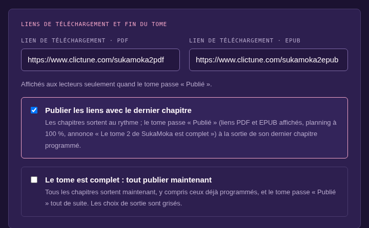{largeur=80%}

1. Ouvrez **Ajouter des chapitres** et choisissez le tome.
2. Déposez le fichier avec les derniers chapitres (ou le tome entier).
3. Collez le **Lien de téléchargement · PDF** et le **Lien de téléchargement · EPUB**.
4. Choisissez le moment :
   - **Publier les liens avec le dernier chapitre** : les chapitres sortent selon la sortie choisie (**Maintenant**, **Un par un, au rythme** ou **À une date**). Le tome passe « Publié » à la sortie du dernier chapitre programmé, ou tout de suite si rien n'est programmé ;
   - **Le tome est complet : tout publier maintenant** : tous les chapitres sortent maintenant, même ceux déjà programmés, et le tome passe « Publié » aussitôt.
5. Cliquez sur le bouton d'envoi, puis confirmez.

Le tome passe « Publié », les liens s'affichent, le planning passe à « Publié », 100 %. L'annonce dit « Le tome 2 de SukaMoka est complet : PDF et EPUB disponibles ».

## Passer un tome à « Publié » depuis sa fiche

Tous les chapitres sont déjà en ligne et il ne manque que les liens ?

1. **Tous les tomes**, puis **Modifier** sur la ligne du tome.
2. Dans l'encadré **État du tome**, choisissez **Publié**.
3. Collez le **Lien PDF** et le **Lien EPUB**.
4. Cochez **Annoncer « Le tome N est complet »** si vous voulez prévenir les lecteurs (décochée par défaut).
5. Cliquez sur **Enregistrer**, puis confirmez si le site le demande.

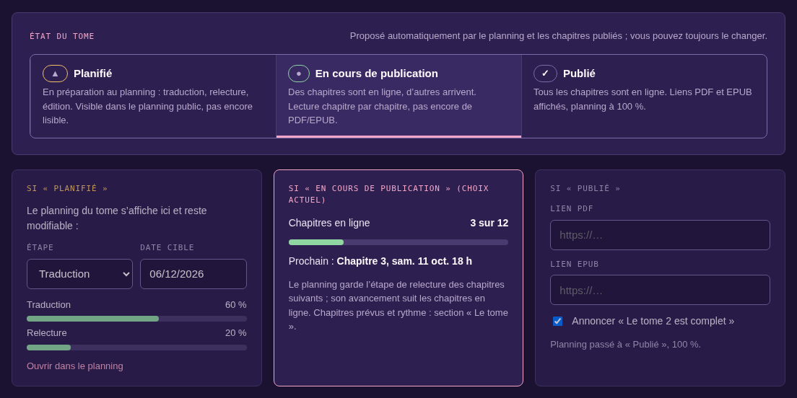{largeur=80%}

> **À savoir** : sans la case d'annonce, rien n'est annoncé : ni article, ni Discord, ni e-mail. Voir aussi le chapitre « Nouveau (version 2.1.5) : l'état des tomes et des œuvres ».

## Remplacer un lien PDF ou EPUB mort

1. **Tous les tomes**, puis **Modifier** sur la ligne du tome.
2. Dans l'encadré **État du tome**, sous **Publié**, remplacez le lien.
3. Cliquez sur **Enregistrer**.

# Modifier un tome

Réservé aux éditeurs et aux gérants. La fiche d'un tome s'ouvre dans l'espace équipe, sans passer par l'administration WordPress.

## Trouver un tome

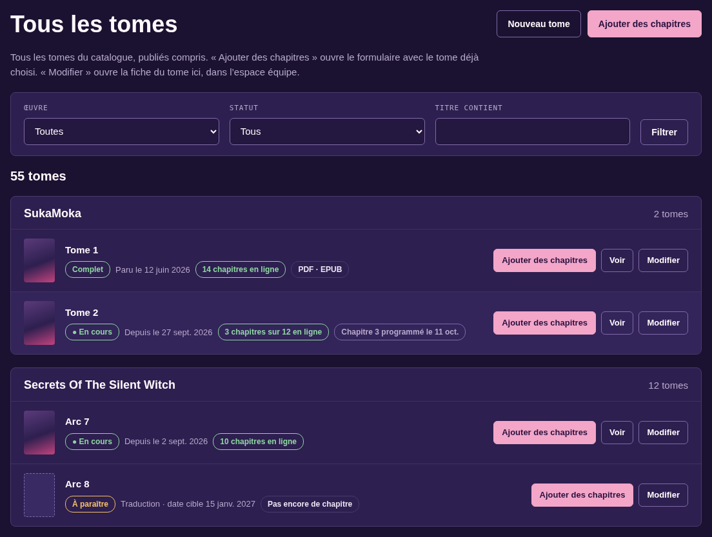

1. Dans le menu, ouvrez **Catalogue**, puis **Tous les tomes**. Les tomes publiés y sont aussi.
2. Filtrez par **Œuvre**, par **Statut** (À paraître, En cours, Complets, Programmés, Brouillons) ou tapez une partie du titre dans **Titre contient**, puis **Filtrer**.
3. Sur la ligne du tome :
   - **Ajouter des chapitres** ouvre le formulaire avec ce tome ;
   - **Voir** ouvre la page publique ;
   - **Modifier** ouvre la fiche du tome.

## Modifier les informations d'un tome

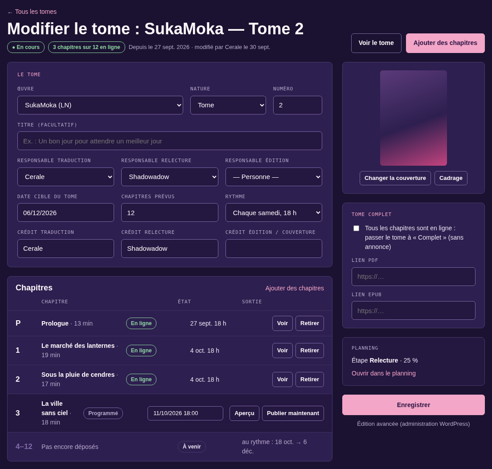

1. Ouvrez la fiche du tome (**Modifier**).
2. Changez ce qu'il faut : œuvre, nature, numéro, titre, responsables, **Chapitres prévus**, **Rythme**. Ces deux derniers champs sont dans la section **Le tome** : ils se corrigent quel que soit l'état du tome (par exemple 6 prévus, mais le DOCX donne 15 chapitres).
3. Pour la sortie : **Date cible du tome** et, à côté, **Heure de sortie**. Laissez l'heure vide si elle n'est pas encore connue.
4. Les **Crédits affichés sur la page du tome** : **Crédit traduction**, **Crédit relecture**, **Crédit édition / couverture**.
5. Pour la couverture : **Changer la couverture (facultatif)**. JPG, PNG ou WebP, au format portrait de préférence. Sans couverture propre, celle de l'œuvre est affichée.
6. Cliquez sur **Enregistrer**.

> **À savoir** : le **Rythme** (un jour ou « Libre ») reprend l'**Heure de sortie** : changer l'heure change aussi l'heure des chapitres proposés au rythme. Un tome déjà programmé garde sa date et son heure de publication.

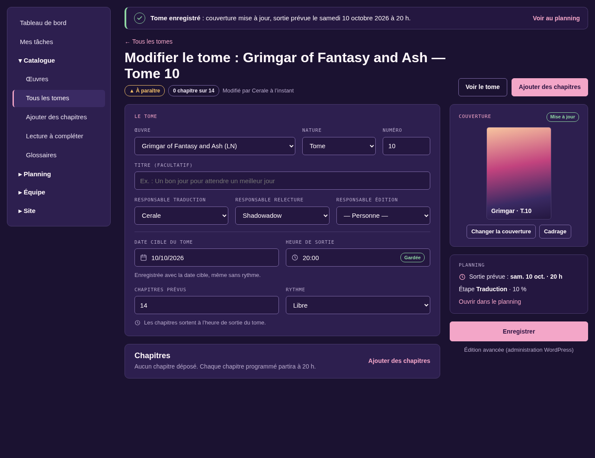

Le résumé **Planning** (étape, avancement) a un lien **Ouvrir dans le planning**. Tout en bas, **Édition avancée (administration WordPress)** ouvre l'ancien écran (rarement utile).

## Publier, reprogrammer ou retirer un chapitre

La liste **Chapitres** de la fiche montre chaque chapitre avec son état : **En ligne**, **Programmé** ou **Brouillon**. Une ligne **À venir** compte les chapitres prévus pas encore déposés.

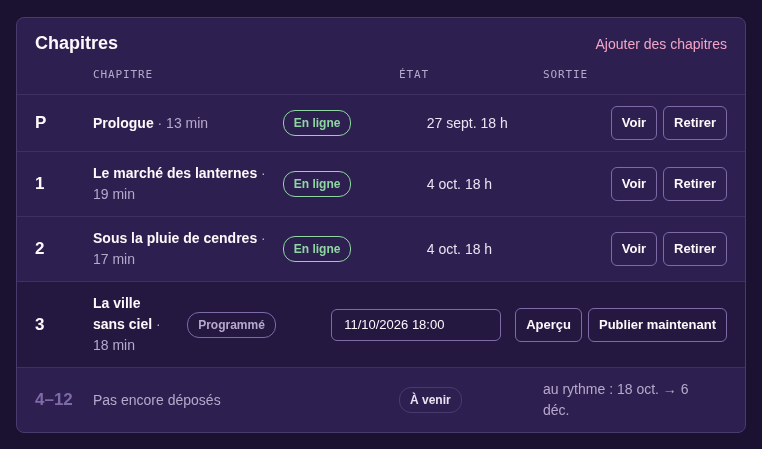{largeur=80%}

- **Publier maintenant** (chapitre programmé ou brouillon) : le chapitre sort tout de suite.
- **Changer la date** (chapitre programmé ou brouillon) : choisissez la date et l'heure, puis cliquez sur le bouton. La date proposée suit le rythme du tome.
- **Retirer** (chapitre en ligne ou programmé) : une question demande confirmation, cliquez sur **Oui, retirer**. Le chapitre repasse en brouillon. Son adresse et ses commentaires sont gardés. Rien n'est annoncé.
- **Voir** (en ligne) ou **Aperçu** (pas encore en ligne) : ouvre le chapitre.

> **À savoir** : la première sortie d'un tome passe toujours par **Ajouter des chapitres**, pour que l'annonce parte. Les boutons de cette liste servent ensuite.

# Nouveau (version 2.1.5) : l'état des tomes et des œuvres

> **Nouveau** : ce chapitre décrit des fonctions de la version 2.1.5. Les images viennent des maquettes : si un détail diffère de l'écran, c'est le texte qui fait foi.

## Le cycle de vie d'un tome

Côté équipe, un tome a trois états. Le site propose l'état tout seul, d'après le planning et les chapitres publiés. L'équipe peut toujours le changer à la main : son choix l'emporte.

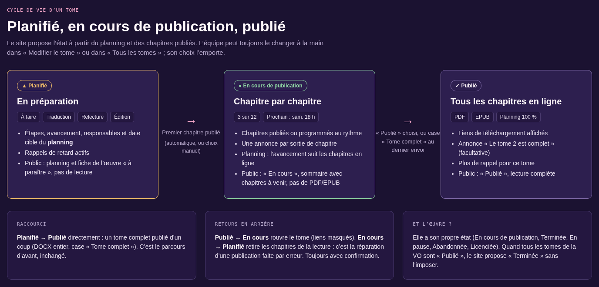

| État (équipe) | Ce que voient les lecteurs | Le tome |
| --- | --- | --- |
| **Planifié** | À paraître | En préparation au planning : traduction, relecture, édition. Pas encore lisible. Rappels de retard actifs. |
| **En cours de publication** | En cours | Des chapitres sont en ligne, d'autres arrivent. Lecture chapitre par chapitre, pas encore de PDF ni d'EPUB. |
| **Publié** | Publié | Tous les chapitres sont en ligne. Liens PDF et EPUB affichés, planning à 100 %, plus aucun rappel. |

Un tome publié d'un coup (fichier entier, case « Le tome est complet : tout publier maintenant ») passe directement de **Planifié** à **Publié**, comme avant.

## Changer l'état d'un tome

1. **Tous les tomes**, puis **Modifier** sur la ligne du tome.
2. Dans l'encadré **État du tome**, cliquez sur **Planifié**, **En cours de publication** ou **Publié**.
3. Complétez les réglages qui s'affichent pour cet état :
   - **Planifié** : l'étape et la date cible du planning ;
   - **En cours de publication** : les chapitres en ligne et le prochain chapitre programmé (les **Chapitres prévus** et le **Rythme** se changent dans la section **Le tome**) ;
   - **Publié** : le **Lien PDF**, le **Lien EPUB** et, si vous le souhaitez, l'annonce « Le tome est complet ».
4. Cliquez sur **Enregistrer**.
5. Si le changement touche les lecteurs, une question demande confirmation. Lisez-la, puis confirmez ou annulez.

## Savoir ce que fait chaque changement

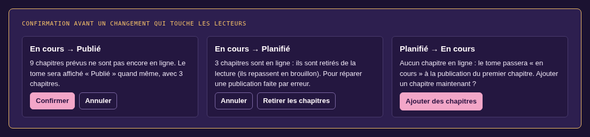

| Changement | Bouton de confirmation | Ce qui se passe |
| --- | --- | --- |
| **Planifié → En cours de publication** | aucun | Rien ne change tant qu'aucun chapitre n'est en ligne. Le site propose d'**Ajouter des chapitres**. |
| **Planifié → Publié** | **Oui, publier le tome** | Le tome et ses chapitres prêts sont publiés. Annonce seulement si vous avez coché la case d'annonce. |
| **En cours de publication → Publié** | **Oui, passer à « Publié »** (demandé s'il manque des chapitres prévus) | Les liens PDF et EPUB s'affichent, le planning passe à « Publié » (100 %). Annonce « Le tome est complet » seulement si la case est cochée. |
| **Publié → En cours de publication** | **Oui, rouvrir le tome** | Le tome est rouvert. Les liens PDF et EPUB sont gardés mais masqués aux lecteurs. Le planning revient à l'étape « Édition ». |
| **En cours de publication → Planifié** | **Oui, retirer de la lecture** | Les chapitres en ligne et programmés repassent en brouillon, le tome aussi, l'annonce est dépubliée et les notifications pas encore parties sont annulées. Le tome redevient « à paraître ». |
| **Publié → Planifié** | cocher **Je comprends que le tome entier ne sera plus lisible**, puis **Oui, retirer le tome de la lecture** | Même retrait, pour le tome entier. |

> **Attention** : le retour **En cours de publication → Planifié** retire les chapitres que les lecteurs pouvaient lire. Il sert à réparer une publication faite par erreur. Pour arrêter un tome sans rien retirer, mettez-le plutôt en pause (voir « Mettre un tome en pause »).

## J'ai publié au lieu de programmer : comment réparer

Exemple : vous vouliez programmer le prologue pour samedi, mais vous avez cliqué sur **Maintenant**. Le tome est passé « En cours » et l'annonce est partie.

1. **Tous les tomes**, puis **Modifier** sur la ligne du tome.
2. Dans **État du tome**, choisissez **Planifié**.
3. Cliquez sur **Enregistrer**, puis confirmez avec **Oui, retirer de la lecture**. Le prologue n'est plus lisible, l'annonce est dépubliée et le tome redevient « à paraître ».
4. Ouvrez **Ajouter des chapitres**, choisissez le tome et déposez de nouveau le fichier : le prologue apparaît **Brouillon**.
5. Choisissez **À une date**, indiquez samedi 18 h, puis cliquez sur **Programmer 1 chapitre** et confirmez. Le prologue sortira samedi, avec son annonce.
6. Prévenez l'équipe sur Discord : le message Discord et les e-mails déjà partis ne peuvent pas être repris. L'article d'annonce, lui, a été dépublié et reviendra à la vraie sortie.

> **Astuce** : si un seul chapitre est sorti trop tôt dans un tome déjà en cours, pas besoin de changer l'état du tome. Utilisez **Retirer** sur la ligne du chapitre, puis **Changer la date** (voir « Publier, reprogrammer ou retirer un chapitre »).

## Changer l'état d'une œuvre

L'état d'une œuvre se change directement dans la liste **Œuvres**, sans ouvrir sa fiche. Il s'affiche sur la bibliothèque, sur la fiche de l'œuvre et dans ses filtres. L'état de chaque tome est rappelé à côté.

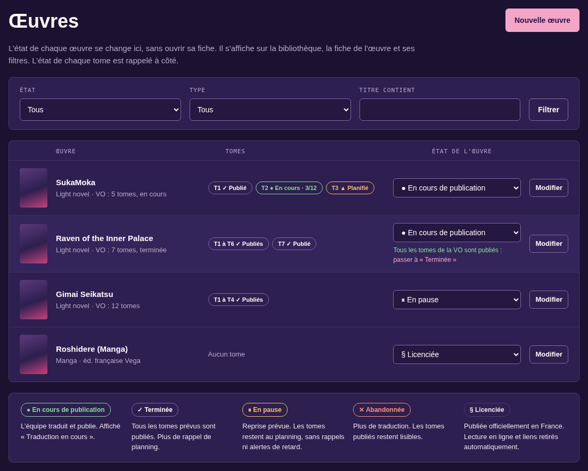

1. Dans le menu, ouvrez **Catalogue**, puis **Œuvres**.
2. Pour retrouver une œuvre, filtrez par **État**, par type, ou tapez une partie du titre.
3. Sur la ligne de l'œuvre, choisissez son nouvel état dans la liste **État de l'œuvre**.
4. Cliquez sur **Changer**. Pour entrer dans « Licenciée » ou en sortir, l'écran **Ce qui va changer** s'ouvre : lisez-le, puis cliquez sur **Confirmer : passer à « … »**.

Vous pouvez aussi changer l'état dans la fiche de l'œuvre (**Modifier**, champ **État de l'œuvre**) : les mêmes confirmations s'appliquent.

| État de l'œuvre | Ce que fait le site |
| --- | --- |
| **En cours de publication** | L'équipe traduit et publie. Les lecteurs voient « Traduction en cours ». |
| **Terminée** | Tous les tomes prévus sont publiés. Plus de rappel de planning. Quand tous les tomes de la VO sont « Publié », le site propose de passer à « Terminée », sans l'imposer. |
| **En pause** | Une reprise est prévue. Les tomes restent au planning, mais le site n'envoie **plus aucun rappel ni alerte de retard** pour cette œuvre. |
| **Abandonnée** | Plus de traduction. Les tomes publiés restent lisibles. Plus de rappel. |
| **Licenciée** | L'œuvre est publiée officiellement en France. Le site **retire automatiquement la lecture en ligne et les liens PDF et EPUB** de tous ses tomes et annule les e-mails d'alerte en attente. La fiche de l'œuvre et ses tomes restent en ligne, avec la mention « Licenciée ». Plus de rappel. |

> **Attention** : **Licenciée** retire tout de suite la lecture et les liens de toute l'œuvre. Vérifiez avec un gérant avant de choisir cet état.

> **À savoir** : c'est réversible. En quittant « Licenciée », la case **Remettre en ligne la lecture et les liens retirés à la licence** (cochée par défaut) remet tout en ligne, sans aucune annonce.

# Ce que voient les lecteurs

Il est utile de savoir ce que montre le site, pour répondre aux lecteurs sur Discord.

> **Nouveau** : depuis la version 2.1.6, l'accueil a une section **Planning** à la place de la carte « Prochaines sorties », et la page Planning montre le prochain tome et une vue **Chapitres**. Rien n'est à saisir en plus : tout vient du planning, des chapitres publiés ou programmés avec **Ajouter des chapitres**, et des champs **Chapitres prévus** et **Rythme** du tome.

## Lire un manga

Un chapitre de manga affiche ses pages à la place du texte. Au-dessus des pages :

- **Défilement** (par défaut) : toutes les pages à la suite, chargées au fil de la lecture ;
- **Page par page** : une page à la fois, entière à l'écran. Un clic sur la moitié droite de la page, la flèche → ou **Page suivante** avancent ; la moitié gauche, la flèche ← ou **Page précédente** reculent ;
- **Économie de données** (par défaut) ou **Originale**, avec le poids approximatif du chapitre (environ 1,6 Mo par page en originale).

Le lecteur garde ces choix sur son appareil. Le marque-page et « Reprendre à la page N » fonctionnent comme pour les romans. Sous les pages : « Images hébergées par MangaDex » et le lien **Lire ce chapitre sur MangaDex**. Une page qui ne se charge pas affiche ce même lien.

## La page d'accueil

En haut, **Dernières sorties** ne change pas : les derniers tomes et chapitres parus. Juste en dessous, la section **Planning**, sur toute la largeur.

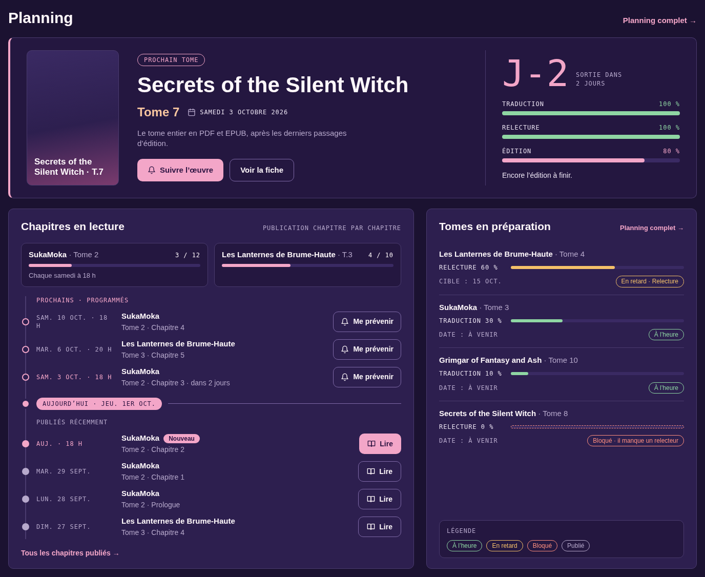

- **À la une : prochain tome** : la couverture, l'œuvre, le tome, la date de sortie avec son heure quand elle est connue, et un compte à rebours (« J-2 », ou « Aujourd'hui à 20 h » le jour même). À droite, les barres **Traduction**, **Relecture** et **Édition**. Les boutons **Suivre l'œuvre** et **Voir la fiche**.
- **Chapitres en lecture**, à gauche :
  - les tomes publiés chapitre par chapitre, avec leur progression (« 3 / 12 ») et leur rythme (« Chaque samedi à 18 h ») ;
  - **Prochains · programmés** : les prochains chapitres programmés, avec leur date et le bouton **Me prévenir** ;
  - le repère **Aujourd'hui** ;
  - **Publiés récemment** : les chapitres parus ces 14 derniers jours, avec **Lire**. Un chapitre de moins de 48 h porte le badge **Nouveau** ;
  - le lien **Tous les chapitres publiés**.
- **Tomes en préparation**, à droite : les tomes suivants, avec leur étape, le pourcentage, la date cible (ou « à venir ») et une pastille d'état (**À l'heure**, **En retard**, **Bloqué**). Une légende explique les pastilles.

Les deux colonnes ont la même hauteur. Sur téléphone, elles deviennent deux onglets : **Chapitres** et **Tomes**. Viennent ensuite, sans changement, les **Actualités**, le Discord et **Nos partenaires**.

> **À savoir** : seules les œuvres publiques apparaissent. Un chapitre retiré (licence, retour d'un tome à « Planifié ») n'apparaît jamais.

> **À savoir** : une **série à venir** apparaît aussi, même en brouillon, mais sous son nom affiché (« Nouvelle série à venir » par défaut) : sans titre, sans couverture, sans lien et sans bouton **Suivre l'œuvre**. Voir « Annoncer une nouvelle série sans dévoiler son titre ».

## La page Planning

La page **yumenovel.fr/planning/** garde tout ce qu'elle montrait : l'introduction, les filtres, les boutons **Flux RSS**, **JSON** et **S'abonner au calendrier (ICS)**, **En bref**, le tableau, le calendrier, le journal et la légende. Ce qui change :

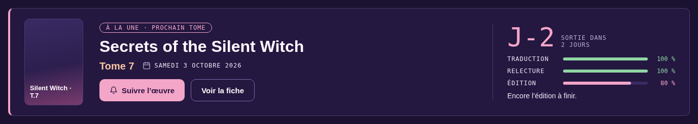

- Sous l'introduction, le bandeau **À la une : prochain tome**, comme à l'accueil.
- Trois vues au lieu de deux : **Tableau**, **Chapitres** et **Calendrier**.
- Dans le tableau, chaque étape a sa barre d'avancement avec son pourcentage.
- Un tome publié chapitre par chapitre affiche « En cours · 3 chapitres sur 12 », une petite barre, « Prochain : ch. 3 · sam. 3 oct. 18 h » et la pastille **En cours de publication**.
- Sur téléphone, le tableau devient une carte par tome.
- Parmi les tomes déjà sortis, la liste ne garde que ceux **parus aujourd'hui** (depuis minuit, heure de Paris) et ceux **en cours de publication** chapitre par chapitre. Un tome paru la veille ou avant quitte la liste : il reste dans la bibliothèque et dans la vue **Calendrier**.

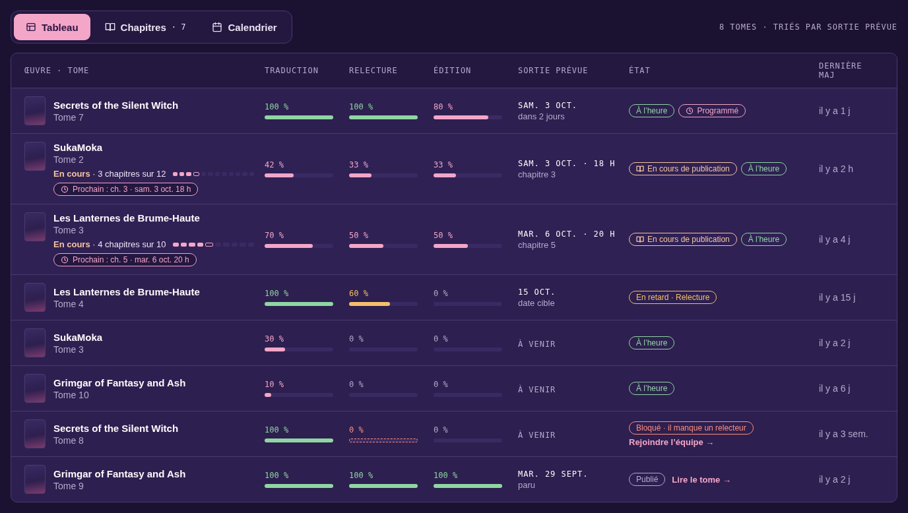

La vue **Chapitres** remplace le tableau par la file des chapitres, groupée par jour : les prochains chapitres programmés, le repère « Aujourd'hui », puis les chapitres publiés. Un encadré rappelle que **les sorties de tomes sont aussi dans le calendrier ICS** (les chapitres n'y sont pas).

Les dates de sortie des tomes portent leur heure quand l'équipe l'a saisie (« sam. 10 oct. · 20 h ») : dans le tableau, dans le bandeau à la une et dans le calendrier ICS, où la sortie devient un événement à l'heure dite (sans heure : un événement sur la journée entière).

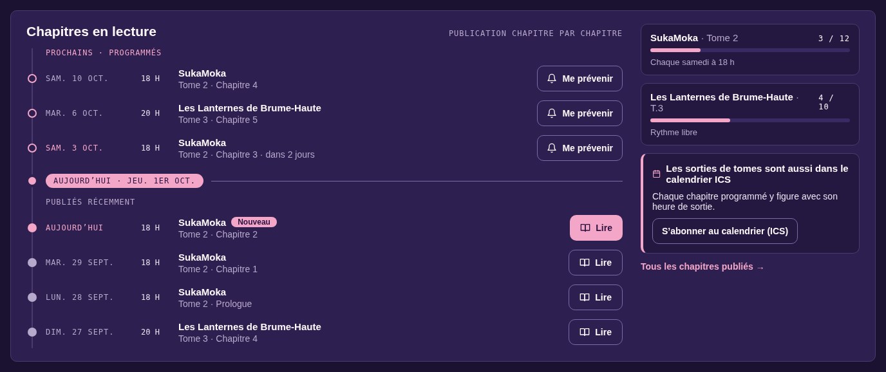

La légende a deux entrées de plus : **En cours de publication** (le tome sort chapitre par chapitre) et **Chapitre programmé** (la date et l'heure du prochain chapitre).

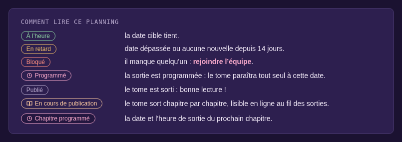{largeur=60%}

## Faire apparaître un chapitre dans « Prochains » de l'accueil

Un chapitre apparaît dans **Prochains · programmés** dès qu'il est programmé. Il n'y a rien d'autre à faire.

1. Ouvrez **Ajouter des chapitres** et choisissez le tome.
2. Déposez le DOCX.
3. Dans la partie 3, choisissez **Un par un, au rythme** (un chapitre à chaque date du rythme du tome) ou **À une date** (le jour et l'heure choisis).
4. Cliquez sur le bouton **Programmer** (son texte donne le nombre de chapitres, par exemple **Programmer 1 chapitre**), puis confirmez.

L'accueil montre les 3 prochains chapitres programmés. À sa sortie, le chapitre passe dans **Publiés récemment**, avec le badge **Nouveau** pendant 48 h, et y reste 14 jours.

> **À savoir** : un chapitre publié tout de suite (**Maintenant**) va directement dans **Publiés récemment**. Pour que l'accueil affiche « 3 / 12 » et le rythme, remplissez **Chapitres prévus** et **Rythme** dans la fiche du tome (voir « Modifier les informations d'un tome »).

## Mettre un tome à la une

Le site choisit tout seul le tome à la une : le tome à venir dont la date de sortie est la plus proche. Pour qu'un tome y figure :

1. Donnez-lui une **Date cible** au planning (dans **Mes tâches** ou dans **Modifier le tome**, avec son **Heure de sortie**), ou programmez sa sortie avec **Ajouter des chapitres** (**À une date**).
2. Vérifiez qu'aucun autre tome à venir n'a une date plus proche.

La date programmée compte en priorité ; sinon, c'est la date cible.

> **Attention** : un tome **bloqué** n'est jamais à la une. Le tome suivant prend sa place jusqu'à ce que **Tome bloqué** soit décoché.

> **À savoir** : un tome déjà en cours de publication chapitre par chapitre n'est pas à la une : il apparaît dans **Chapitres en lecture**. Un tome publié, ou d'une œuvre qui n'est pas publique, n'y est jamais non plus. Exception : le tome d'une **série à venir** peut être à la une, sous le nom affiché au public.

## La fiche d'une œuvre

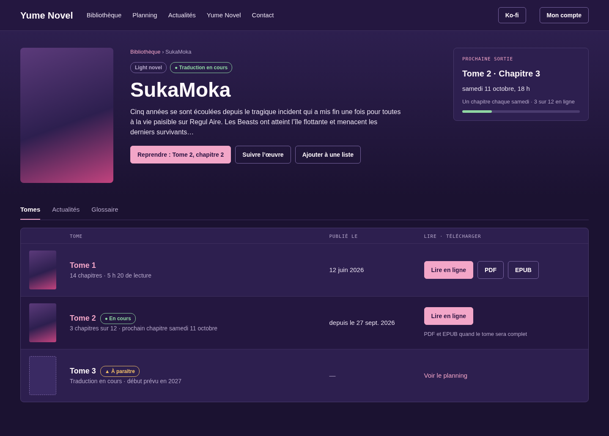

- En haut : la couverture, le type, l'état de la traduction, le synopsis et les boutons pour reprendre la lecture, mettre l'œuvre en favori (avec une alerte à chaque sortie) et l'**Ajouter à une liste**.
- À droite : la **Prochaine sortie**, quand un chapitre est programmé.
- La liste des tomes : chaque tome avec sa parution (**À paraître**, **En cours**, **Publié**), **Lire en ligne** et, pour un tome publié, **PDF** et **EPUB**.
- Les onglets **Actualités** et **Glossaire** apparaissent quand l'œuvre en a.
- **Si vous avez aimé…** : jusqu'à 4 œuvres proches, après le sommaire des tomes (voir « Les suggestions et les nouveaux chapitres »).

## Les suggestions et les nouveaux chapitres

> **Nouveau** : depuis la version 2.5, le site suggère des œuvres et signale aux lecteurs connectés les chapitres sortis depuis leur dernière lecture. Rien n'est à saisir par l'équipe.

- **Si vous avez aimé…**, sur la fiche d'une œuvre : des œuvres qui partagent ses genres ou son type, ou que suivent les mêmes lecteurs (« 4 lecteurs la suivent aussi », à partir de 3 lecteurs en commun, sans jamais nommer personne). Jamais d'œuvre licenciée. Un lecteur connecté n'y voit pas ses favoris ni ce qu'il lit déjà.
- **Pour vous**, dans **Mon compte** : des suggestions tirées de ses favoris et de ses lectures, « parce que vous suivez… ».
- **Nouveaux chapitres depuis votre dernière lecture**, sur l'accueil et dans **Mon compte**, rubrique **À rattraper** : les séries qu'il a commencées et qui ont de nouveaux chapitres, avec **Reprendre** et **Chapitre suivant**. Seulement pour un lecteur connecté.

> **Astuce** : des **genres** bien renseignés sur chaque œuvre donnent de meilleures suggestions. Sans au moins 2 œuvres proches, le bloc n'apparaît pas.

## La page d'un tome en cours

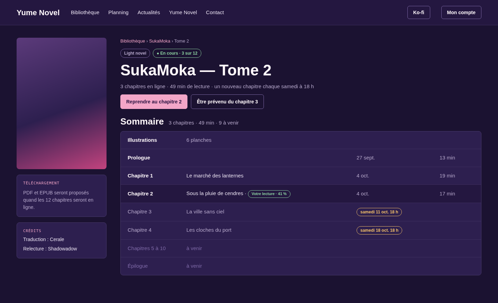

- Le titre, « En cours · 3 sur 12 » et le rythme : « un nouveau chapitre chaque samedi à 18 h ».
- Le **Sommaire** : les chapitres en ligne, les chapitres programmés avec leur date, puis les chapitres « à venir ».
- **PDF et EPUB seront proposés quand les 12 chapitres seront en ligne** : les liens n'apparaissent qu'une fois le tome complet.
- Les **Crédits** : traduction, relecture, édition.

# Les statistiques d'audience

Le menu **Site**, puis **Statistiques**, montre l'audience du site et de chaque œuvre : vues, visiteurs, favoris, lecteurs. Toute l'équipe y a accès. Les chiffres sont des totaux : aucun lecteur n'y est nommé, sauf dans la liste des lecteurs d'une œuvre, réservée aux gérants.

| Mot | Ce qu'il compte |
| --- | --- |
| **Vues**, **Visiteurs** | Pages vues et visiteurs, mesurés par Jetpack (WordPress.com) |
| **Favoris** | Lecteurs qui ont mis l'œuvre en favori (« suivre » une œuvre, c'est la mettre en favori) |
| **Suiveurs alertés** | Favoris avec une alerte **Immédiate** ou **Hebdomadaire** (sans l'alerte **Jamais**) |
| **Lecteurs** | Comptes qui ont une position de lecture sur l'œuvre (lecture en ligne, connecté) |
| **Lecteurs actifs** | Comptes dont la position de lecture a bougé sur la période (ou sur 30 jours pour **Actifs 30 j**) |
| **Chapitres lus (est.)** | Estimation tirée de la position de lecture : les chapitres qui la précèdent, plus le chapitre en cours s'il est lu à 90 % |

## Lire l'aperçu

1. Dans le menu, ouvrez **Site**, puis **Statistiques**.
2. Sous **Période**, choisissez **7 jours**, **30 jours**, **90 jours** ou **12 mois**, puis cliquez sur **Afficher**. La période reste choisie quand vous changez d'onglet.
3. L'onglet **Aperçu** affiche les chiffres clés, comparés à la période précédente de même durée (▲ hausse, ▼ baisse), la courbe des vues et des visiteurs, et les œuvres les plus suivies et les plus vues.

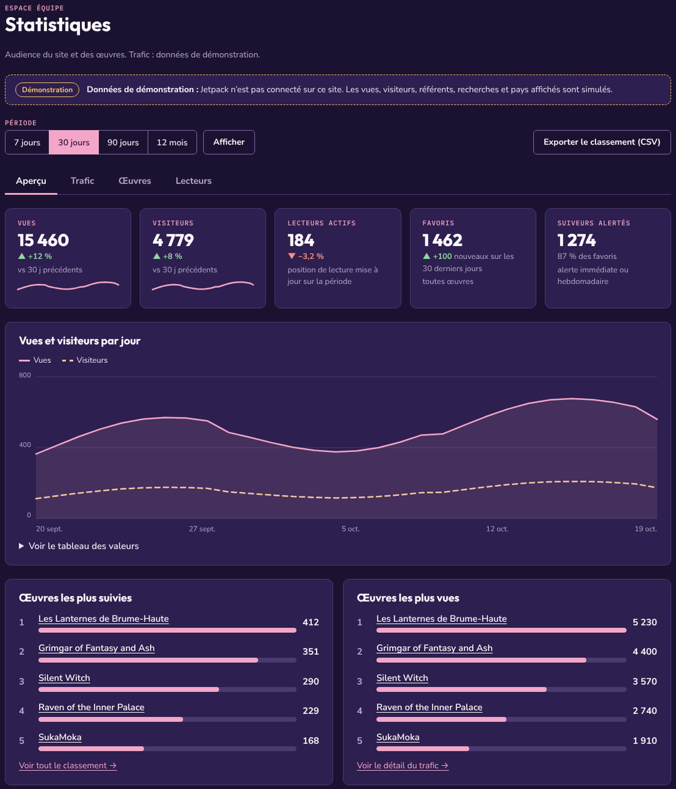{largeur=80%}

Les autres onglets :

- **Trafic** : vues et visiteurs par jour (par mois sur 12 mois), contenus les plus vus, vues regroupées par œuvre (fiche, tomes et chapitres), sites qui envoient des visiteurs (**Référents**), **Termes de recherche** et **Pays** (jamais de ville) ;
- **Œuvres** : le classement de toutes les œuvres. Choisissez **Trier par** (**Favoris**, **Suiveurs alertés**, **Lecteurs**, **Vues**, **Nouveaux favoris**, **Croissance 30 j**), puis **Trier** ;
- **Lecteurs** : comptes lecteurs, inscriptions, lecteurs actifs, part des comptes qui ont au moins un favori, fréquence des alertes choisie par les lecteurs. Personne n'y est nommé.

> **Astuce** : sous chaque courbe, **Voir le tableau des valeurs** affiche les chiffres jour par jour. Survolez la courbe pour lire la valeur d'un jour.

## Consulter les statistiques d'une œuvre

1. Ouvrez l'onglet **Œuvres** (ou cliquez sur une œuvre dans l'**Aperçu**).
2. Cliquez sur le titre de l'œuvre.
3. La fiche affiche ses favoris, suiveurs alertés, lecteurs, lecteurs actifs, chapitres lus estimés et vues, l'évolution jour par jour, sa place dans les listes de lecture des lecteurs (**À lire**, **En cours**, **Terminé**, listes personnelles : chiffres seulement) et les lecteurs de chaque tome.
4. **Voir la fiche publique** ouvre la page de l'œuvre sur le site ; **← Retour au classement des œuvres** ramène au classement.

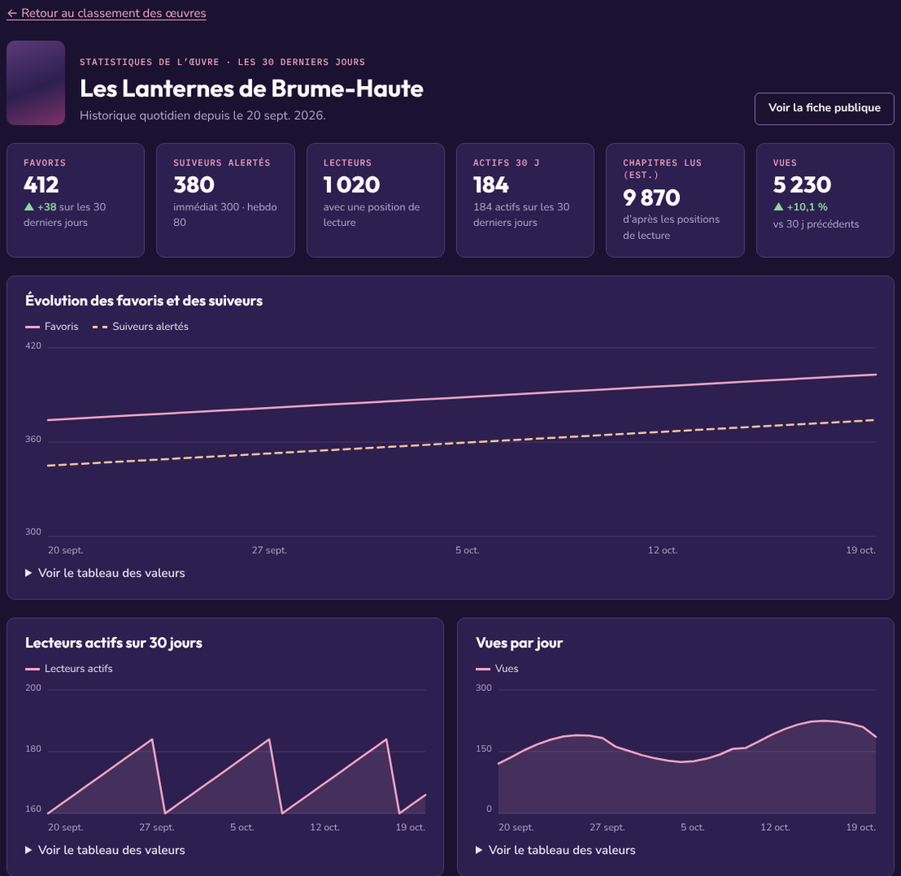{largeur=80%}

> **À savoir** : l'historique jour par jour commence le jour où la fonction a été installée sur le site. Les courbes se remplissent au fil des jours ; la fiche indique depuis quand.

## Voir qui suit une œuvre (gérants)

Réservé aux gérants et aux administrateurs. Les autres membres voient seulement le nombre de lecteurs, avec la mention « La liste des pseudos est réservée aux gérants et administrateurs (RGPD) ».

1. Ouvrez la fiche statistique de l'œuvre (procédure précédente).
2. Descendez jusqu'à **Lecteurs qui suivent l'œuvre**.
3. Choisissez **Favoris** (tous) ou **Suiveurs alertés** (alerte immédiate ou hebdomadaire).
4. Pour retrouver quelqu'un, tapez au moins 2 caractères dans **Rechercher un pseudo**, choisissez **Trier par** (**Date d'ajout** ou **Pseudo**), puis cliquez sur **Rechercher**.
5. Pour garder la liste, cliquez sur **Exporter la liste (CSV)**.

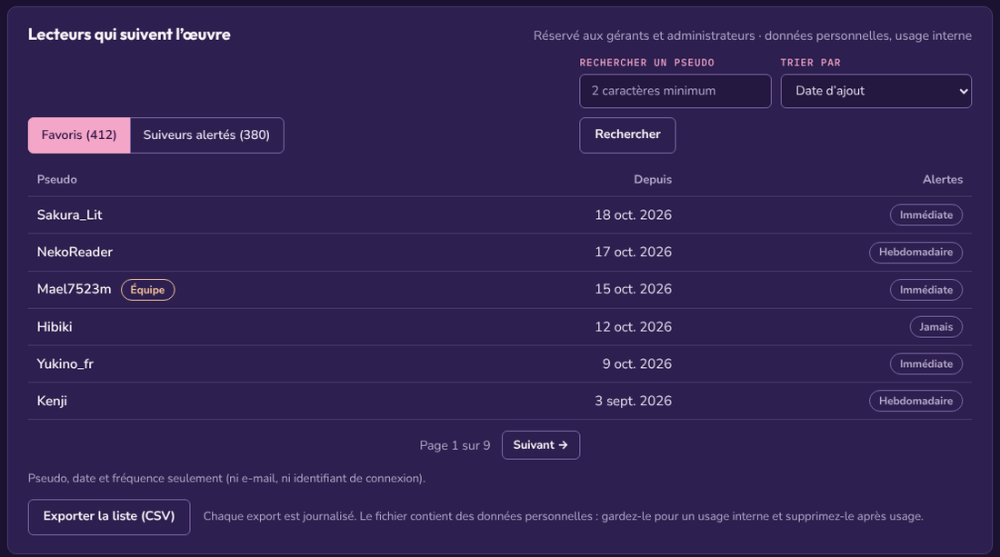{largeur=80%}

La liste ne montre que le **pseudo**, la date d'ajout et la fréquence d'alerte, avec une pastille **Équipe** pour les membres. Jamais d'adresse e-mail. Un compte supprimé disparaît de la liste.

> **Attention** : ce sont des données personnelles. Ne les recopiez pas sur Discord ni ailleurs. Chaque export est enregistré (qui, quand, quelle œuvre) : gardez le fichier pour un usage interne et supprimez-le après usage.

## Exporter le classement des œuvres

1. Choisissez la période (et, dans l'onglet **Œuvres**, le tri).
2. Cliquez sur **Exporter le classement (CSV)**, en haut à droite.
3. Ouvrez le fichier avec Excel ou LibreOffice : une ligne par œuvre, sans aucun nom de lecteur.

## Comprendre les données de démonstration

Sur le site en ligne, les vues et les visiteurs viennent de Jetpack. Sur un site de test (Playground, ordinateur d'un développeur), Jetpack n'est pas connecté : un bandeau **Démonstration** l'indique, et les vues, visiteurs, référents, recherches et pays sont inventés.

> **À savoir** : si le site en ligne affiche « Trafic indisponible » ou des vues vides, Jetpack n'y est pas connecté ou ne répond pas : prévenez l'équipe technique. Favoris, lecteurs et classements restent justes.

# Les coquilles signalées par les lecteurs

> **Nouveau** : depuis la version 2.5, les lecteurs signalent une coquille directement dans le chapitre. Les signalements arrivent dans l'espace équipe, menu **Catalogue**, puis **Corrections**.

## Comprendre ce que fait le lecteur

1. Dans un chapitre, le lecteur connecté sélectionne le passage fautif.
2. Il clique sur **Signaler une coquille**, ajoute s'il veut un **Commentaire (facultatif)**, puis clique sur **Envoyer**.
3. Le message « Merci ! L'équipe a reçu votre signalement. » s'affiche.

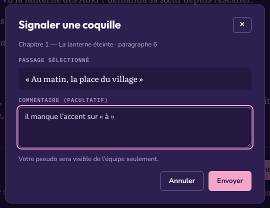{largeur=55%}

Au clavier, le lien **Signaler une coquille dans ce chapitre**, sous les boutons du chapitre, ouvre la même fenêtre. Un visiteur non connecté est invité à se connecter. Rien n'apparaît sur un chapitre de manga.

> **À savoir** : le pseudo du lecteur n'est visible que de l'équipe. Chaque signalement est aussi annoncé dans le salon Discord de l'équipe, au plus un message par chapitre toutes les 10 minutes.

## Traiter une coquille

Réservé aux éditeurs et aux gérants. Les autres membres voient la liste, sans les boutons : prévenez un éditeur sur Discord.

1. Dans le menu, ouvrez **Catalogue**, puis **Corrections (N)**. N est le nombre de signalements nouveaux.
2. Les signalements sont groupés par chapitre. Chacun montre **¶** et le numéro du paragraphe, le passage surligné, le commentaire du lecteur, son pseudo et la date.
3. Cliquez sur **Voir le paragraphe** : le chapitre s'ouvre dans un nouvel onglet, au bon paragraphe.
4. Cliquez sur **Corriger dans l'éditeur**, corrigez le texte, puis **Mettre à jour**.
5. Revenez sur **Corrections** et cliquez sur **Corrigé**. Le lecteur reçoit une notification : « Votre signalement sur … a été corrigé, merci ! ».

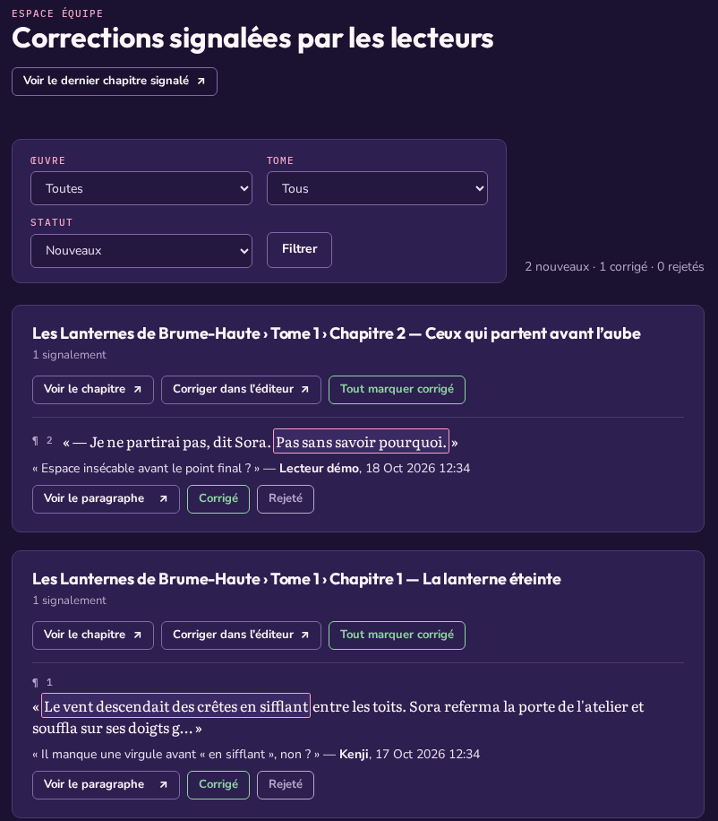{largeur=80%}

Ce n'est pas une faute (choix de traduction, style voulu) ? Cliquez sur **Rejeté** : le lecteur n'est pas prévenu. **Rouvrir** remet un signalement traité dans les nouveaux.

> **Astuce** : plusieurs lecteurs ont signalé la même coquille ? Après correction, **Tout marquer corrigé**, en tête du chapitre, traite tous ses signalements nouveaux d'un coup.

> **À savoir** : la pastille **Paragraphe modifié depuis** signale que le paragraphe a changé depuis le signalement (déjà corrigé, ou texte remplacé). Vérifiez, puis cliquez sur **Corrigé**. Rien n'est clôturé tout seul.

## Retrouver les signalements traités

1. Sous **Statut**, choisissez **Corrigés**, **Rejetés** ou **Tous**. Vous pouvez aussi choisir une **Œuvre** et un **Tome**.
2. Cliquez sur **Filtrer**.

> **À savoir** : l'entrée **Corrections** n'apparaît dans le menu qu'après le premier signalement reçu. Les signalements traités sont effacés au bout de 180 jours.

# Glossaires, actualités et commentaires

## Publier le glossaire d'une œuvre

Réservé aux éditeurs et aux gérants. Le glossaire vient du fichier `glossaire.yaml` de Yume-Trad.

1. Dans le menu, ouvrez **Catalogue**, puis **Glossaires**.
2. Sous **Téléverser un glossaire**, choisissez l'**Œuvre** et le **Fichier YAML (4 Mo au plus)**.
3. Cliquez sur **Vérifier**. Rien n'est publié : le site affiche le nombre d'entrées et les entrées ignorées.
4. Si le bilan est bon, cliquez sur **Publier le glossaire**. Le nouveau fichier remplace l'ancien.

Les 5 dernières versions restent disponibles : **Télécharger ce YAML** ou **Restaurer cette version**.

## Lier une actualité à une œuvre

Un article d'actualité lié à une œuvre apparaît sur sa fiche, dans l'onglet **Actualités**. Pour le lier, cochez l'œuvre dans le panneau **Œuvres liées** de l'éditeur d'article. Les annonces de sortie sont liées toutes seules.

## Modérer les commentaires

Réservé aux éditeurs et aux gérants. L'entrée **Commentaires (N)** apparaît dans le menu dès qu'il y a quelque chose à modérer. Elle liste les commentaires **signalés** par les lecteurs, puis ceux **En attente**.

Pour chaque commentaire :

- **Approuver** : le publie et classe ses signalements ;
- **Ignorer les signalements** : le commentaire reste en ligne ;
- **Indésirable** : pour la publicité et le spam ;
- **Corbeille** : pour ce qui enfreint les règles (insultes, spoilers non signalés, liens pirates).

> **À savoir** : au 3ᵉ signalement, un commentaire est masqué en attendant votre décision. Un commentaire d'un membre de l'équipe n'est jamais masqué tout seul.

> **Astuce** : un commentaire signale une coquille ? Corrigez le chapitre (voir « Corriger un chapitre déjà en ligne »), répondez « Corrigé, merci ! », puis approuvez ou supprimez le commentaire. La prochaine fois, le lecteur peut utiliser **Signaler une coquille** dans le chapitre.

# Questions fréquentes

| Question | Réponse |
| --- | --- |
| Je ne vois pas mon tome dans **Mes tâches**. | Vous n'en êtes pas responsable. Demandez à un éditeur ou à un gérant de vous l'attribuer. |
| Le planning dit « En retard » alors que j'avance. | Personne n'a mis le tome à jour depuis 14 jours. Enregistrez votre avancement, même sans changer d'étape. |
| Je ne vois pas **Ajouter des chapitres** ni **Œuvres**. | Ces menus sont réservés aux éditeurs et aux gérants. |
| Un tome est arrêté mais reçoit des rappels. | **Planning complet**, dépliez sa ligne, **Mettre en pause**. **Reprendre** le jour où il repart. |
| J'ai créé un tome par erreur. | **Planning complet**, dépliez sa ligne, **Retirer du planning** (tome brouillon sans chapitre en ligne). |
| J'ai publié un chapitre trop tôt. | Fiche du tome, ligne du chapitre : **Retirer**, puis **Changer la date**. Pour un tome entier, voir « J'ai publié au lieu de programmer : comment réparer ». |
| Tous les chapitres de mon fichier sont sortis d'un coup. | Tous les chapitres **Nouveau** sortent ensemble. La prochaine fois, choisissez **Un par un, au rythme**, ou déposez un fichier avec les seuls chapitres à publier. |
| Les chapitres sont mal découpés. | Vérifiez les styles **Titre 1** dans Word et déposez de nouveau le fichier. Sinon, découpez vous-même (voir « Découper soi-même les chapitres »). |
| Un lien PDF ou EPUB ne marche plus. | **Tous les tomes**, **Modifier**, encadré **État du tome** (**Publié**) : remplacez le lien, puis **Enregistrer**. |
| Le tome publié n'apparaît pas sur le site. | Il est encore en brouillon ou programmé. Vérifiez son statut dans **Tous les tomes** (filtre **Statut**). |
| Un lecteur ne reçoit pas les alertes. | Il doit avoir l'œuvre en favori, avec une alerte active (page **Mon compte**). |
| Je ne vois pas la liste des lecteurs d'une œuvre dans **Statistiques**. | Elle est réservée aux gérants et aux administrateurs. Les chiffres restent visibles pour toute l'équipe. |
| Les courbes d'une œuvre sont presque vides. | L'historique jour par jour a commencé à l'installation des statistiques : il se remplit chaque nuit. |
| J'ai oublié mon mot de passe. | Lien **Mot de passe oublié ?** sur la page de connexion. |
| Un lecteur ne retrouve pas son identifiant. | Qu'il se connecte avec son **adresse e-mail**. Depuis la version 2.5, l'identifiant d'un nouveau compte n'est jamais montré. Mot de passe perdu : **Mot de passe oublié ?** avec la même adresse. |
| Je ne vois pas **Corrections** dans le menu. | L'entrée apparaît au premier signalement de coquille reçu. |
| Je vois les coquilles mais pas les boutons **Corrigé** et **Rejeté**. | Ils sont réservés aux éditeurs et aux gérants. Prévenez un éditeur sur Discord. |
| Une fiche d'œuvre n'affiche pas **Si vous avez aimé…**. | Il faut au moins 2 œuvres proches. Complétez les genres de l'œuvre. |

# En cas de problème

## Qui contacter

| Problème | Qui contacter |
| --- | --- |
| Un rôle à changer, un accès qui manque, un tome à attribuer | Un **gérant** |
| Une coquille (aussi dans **Corrections**), un chapitre à corriger ou à publier | Un **éditeur Yume** |
| Une page cassée, un bouton qui ne répond plus, un message d'erreur | L'**équipe technique**, sur le Discord de l'équipe |
| Un compte bloqué, un changement d'adresse e-mail | Un **administrateur** (via un gérant) |

Tout passe par le **Discord de l'équipe**. Le site ne recueille aucune demande par formulaire.

## Signaler un problème

Pour qu'on puisse vous aider vite, envoyez sur Discord :

1. l'adresse de la page (copiez-la depuis la barre d'adresse) ;
2. ce que vous vouliez faire, et sur quel tome ;
3. le message affiché, en entier ;
4. une capture d'écran.

> **Astuce** : beaucoup de messages expliquent eux-mêmes quoi faire. Par exemple « Votre session a expiré : rechargez la page puis réessayez. » : rechargez la page (touche **F5**) et recommencez.

> **À savoir** : le site se met à jour tout seul quand l'équipe technique publie une nouvelle version. Rien à faire de votre côté. Ce guide est mis à jour en même temps : vérifiez sa version en bas de page.
